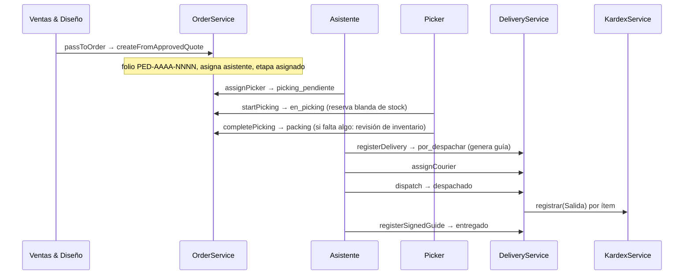
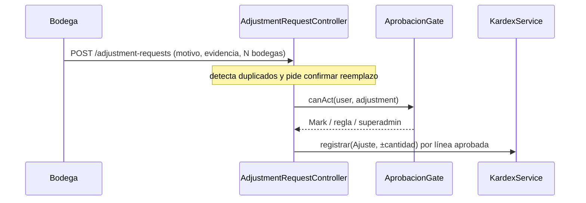

# Manual técnico — Bodega

<!-- nav-manuales:inicio -->
> **Navegación:** [Índice de manuales](README.md) · ← [Compras](compras.md) · [Admin & Contabilidad](admin-contabilidad.md) →
> **Módulos relacionados:** [Compras](compras.md) · [Ventas & Diseño](ventas-diseno.md) · [Admin & Contabilidad](admin-contabilidad.md) · [Servicios](servicios.md)
<!-- nav-manuales:fin -->

> **Para quién:** un desarrollador que nunca ha tocado este módulo y necesita entenderlo y modificarlo con seguridad.
> **Base del manual:** backend `atlanticerp-backend` rama `dev` (commit `887904e6`, 2026-10-12) y frontend `atlanticerp-frontend` `origin/dev` (commit `95cc675`, 2026-10-12).
> **Cómo se verifica:** `python3 scripts/manual-coverage.py bodega` comprueba que cada pieza del módulo esté nombrada aquí. Mide presencia, no calidad.
> **Documentos hermanos:** diagrama `docs/architecture/diagramas/bodega.md`, ERD `docs/architecture/erd/bodega.md`, API `docs/api/exports/openapi/bodega.json`, y los ADR `ADR-SCRUM406`, `ADR-SCRUM433-445`, `ADR-SCRUM454-459`, `ADR-SCRUM460-466`, `ADR-SCRUM473-489` en `docs/adr/`. Manual de Compras (módulo vecino): `compras.md`.

---

## 1. Propósito y alcance

Bodega gestiona el movimiento físico de la mercancía y su registro:

| Área | Qué resuelve |
|---|---|
| **Pedidos (tablero Kanban)** | Un pedido de venta aprobado recorre 7 etapas: asignado, picking pendiente, en picking, packing, por despachar, despachado, entregado. |
| **Picking y entrega** | Asignar picker, hoja de picking, picking parcial, revisión de inventario, guía de entrega, repartidor, despacho y guía firmada. |
| **Inventario de Bodega** | Pantalla de solo lectura del catálogo con "por servir" propio (pedidos de Bodega), por ingresar, en camino y confirmación de llegada física. |
| **Bodegas** | Las 7 bodegas físicas, ubicaciones, espacio libre y stock por bodega. |
| **Kardex** | Registro inmutable de todos los movimientos de stock. |
| **Ajustes, reubicaciones y conteos** | Solicitudes que Mark aprueba y que modifican el stock a través del Kardex. |
| **Devoluciones de cliente** | Ciclo completo, desde una guía de entrega real hasta la nota de crédito. |
| **Zona Libre** | Solicitudes de orden de compra al proveedor "Zona Libre de Colón" y catálogo de solo consulta de Lafayette Lighting. |
| **Home, reportes y ajustes** | Inicio con paneles, cuatro reportes y umbrales configurables. |

**Quiénes lo usan.** Los cuatro roles propios (`App\Modules\Bodega\Support\BodegaRoles`): `lider_bodega` (jefe), `asistente_bodega`, `ayudante_general_bodega` (el *picker*) y `transporte` (el repartidor). No hay modelos de picker ni de repartidor: son usuarios con ese rol. Mark (configurado en `ComprasSettings`, ver el manual de Compras) aprueba ajustes, reubicaciones y conteos. Gerencia y Ventas & Diseño consultan.

**Qué no es Bodega.** Los pedidos nacen en Ventas & Diseño (`PipelineService::passToOrder()`, SCRUM-1128). Las órdenes de compra son de Compras. La factura es de Admin & Contabilidad: Bodega solo la lee. El catálogo de productos (`CatalogProduct`) es de Ventas & Diseño.

---

## 2. Mapa del código

### 2.1 Backend (`atlanticerp-backend/app/Modules/Bodega/`)

| Carpeta | Contenido |
|---|---|
| `Http/Controllers/` | 21 controladores (ver 6). |
| `Http/Requests/` | Solo `BodegaSettingsRequest`. **El resto se valida con `$request->validate(...)` dentro del controlador.** |
| `Models/` | 19 modelos (ver 3). |
| `Services/` | 27 servicios; la lógica de negocio vive aquí, no en los controladores. `Services/Concerns/ChangesOrderStage.php` es el único camino para cambiar la etapa de un pedido. |
| `Events/` | 12 eventos de dominio. |
| `Listeners/` | `MarkOrderInvoiceReady` y `ReleaseOrdersAwaitingStock`. |
| `Exceptions/` | 5 excepciones de negocio. |
| `Support/` | `BodegaRoles` y `ReportPeriod`. |

Piezas que están fuera de esta carpeta pero son del módulo:

| Archivo | Para qué |
|---|---|
| `routes/bodega.php` | Rutas, montadas bajo `api/bodega`. |
| `app/Console/Commands/` (comandos `bodega:*` y `lafayette:*`) | Rellenos de datos y sincronización del catálogo Lafayette (ver 10). |
| `app/Shared/Support/AprobacionGate.php` | Gate de aprobación compartido con Compras y Gerencia. |
| `app/Modules/VentasDiseno/Services/PipelineService.php` (`passToOrder()`) | Crea el pedido de Bodega. |
| `app/Modules/AdminCont/...InvoiceService` | Bodega lee la factura real, no la duplica. |

### 2.2 Frontend (`atlanticerp-frontend/src/`)

Bodega no tiene una carpeta única: sus pantallas están planas en `pages/`, y las del tablero de pedidos usan componentes sueltos en `components/`.

| Ruta | Contenido |
|---|---|
| `pages/Bodega*.tsx`, `pages/BodegasPage.tsx` | Pantallas del módulo. |
| `pages/PedidosPage.tsx`, `pages/OrderStatusPage.tsx`, `pages/KardexPage.tsx`, `pages/SolicitudAjustePage.tsx` | Pantallas que no llevan "Bodega" en el nombre. |
| `components/bodega/` | Reportes, devoluciones, Zona Libre y utilidades de tablas. |
| `components/` (sueltos) | `OrderCardTile`, `OrderDetailModal`, `OrderStatusDetailModal`, `PickingSheetModal`, `ConsolidatedPickingModal`, `InventoryReviewModal`, `RegisterDeliveryModal`, `RegisterSignedGuideModal`, `GuiaEntregaModal`, `InvoiceStatusModal`, `BodegaSettingsPanel`. |
| `api/bodegaApi.ts`, `hooks/useBodega.ts`, `types/bodega.ts` | Capa de datos y tipos. |
| `utils/searchSuggestionsBodega.ts` | Sugerencias de búsqueda. |
| `i18n/locales/{es,en}/bodega.json` | Textos. |

**Para encontrar todo el frontend de Bodega** no basta con buscar "Bodega" en los nombres de archivo: busca los archivos que importan `@/api/bodegaApi` o `@/hooks/useBodega`. El script de cobertura lo hace así.

### 2.3 Cómo viaja una petición

```
React (página → hook useBodega → bodegaApi, axios con JWT)
  → nginx /api/bodega/... → Laravel (grupo `api`: AuthenticateJwt)
  → middleware `permission:...` → Controller
  → (validación inline) → Service → Models
  → todo cambio de stock → KardexService::registrar()
  → todo cambio de etapa de un pedido → ChangesOrderStage::transitionStage()
```

---

## 3. Modelo de datos

Esquema PostgreSQL por tenant: `{tenant}_bodega`. Todos los modelos sobrescriben `getTable()` para anteponerlo. ERD completo: `docs/architecture/erd/bodega.md`.

### 3.1 Tablas

| Tabla | Modelo | Qué guarda |
|---|---|---|
| `orders` | `Order` | Pedido. `order_number` (folio `PED-AAAA-NNNN`), `order_type`, `stage`, familia (`family_id`, `sequence_in_family`, `total_in_family`), personas (`assistant_id`, `picker_id`, `courier_id`), `committed_delivery_date`, datos del cliente y `pipeline_card_id` (origen en Ventas & Diseño). |
| `order_items` | `OrderItem` | Ítem copiado de la cotización aprobada (copia, no referencia en vivo): `qty_requested`, `qty_picked`, `qty_delivered`, `qty_reserved`, `warehouse_id`, `unit_price`, motivo de faltante. `catalog_product_id` puede ser nulo (ítem personalizado). |
| `order_stage_history` | `OrderStageHistory` | Historial de cambios de etapa. **Solo se agrega**, nunca se edita. |
| `order_documents` | `OrderDocument` | Guía de entrega y estatus del pedido generados. Solo se agrega. |
| `order_folio_counters` | `OrderFolioCounter` | Contador atómico del folio, una fila por año. |
| `product_warehouse_stock` | `ProductWarehouseStock` | Stock por producto y bodega, más `ubicacion` y `cliente_id`. Sin fila = 0 unidades. |
| `inventory_movements` | `InventoryMovement` | Kardex. **Inmutable**: sin `updated_at`, se crea solo con `KardexService::registrar()`. |
| `warehouses` | `Warehouse` | Catálogo fijo de 7 bodegas físicas, sembrado por migración, sin CRUD en la interfaz. |
| `warehouse_locations` | `WarehouseLocation` | Ubicaciones físicas de una bodega; se desactivan (`is_active`), no se borran. |
| `warehouse_assistant_mapping` | `WarehouseAssistantMapping` | Vendedor → asistente de Bodega. Un solo mapeo activo por vendedor (índice único parcial). |
| `adjustment_requests` | `AdjustmentRequest` | Solicitud de ajuste (contenedora). |
| `adjustment_request_lines` | `AdjustmentRequestLine` | Una bodega dentro del ajuste, con su propio estado. |
| `relocation_requests` | `RelocationRequest` | Reubicación de un producto entre dos bodegas. |
| `general_count_requests` | `GeneralCountRequest` | Conteo general de una bodega completa. |
| `general_count_request_lines` | `GeneralCountRequestLine` | Producto dentro de un conteo. |
| `customer_returns` | `CustomerReturn` | Devolución de cliente. |
| `customer_return_lines` | `CustomerReturnLine` | Producto devuelto. |
| `return_folio_counters` | `ReturnFolioCounter` | Folio `DEV-AAAA-NNNN`. |
| `bodega_settings` | `BodegaSetting` | Umbrales configurables (clave y valor). |
| `lafayette_productos` | — (sin modelo Eloquent) | Espejo del catálogo de Lafayette Lighting, de solo lectura; lo carga el comando `lafayette:sync-productos`. |

### 3.2 Estados

**Pedido (`Order::STAGE_ORDER`):**

```
asignado → picking_pendiente → en_picking → packing → por_despachar → despachado → entregado
```

| Transición | La ejecuta |
|---|---|
| asignado → picking_pendiente | `PickingService::assignPicker()` |
| picking_pendiente → en_picking | `PickingService::startPicking()` (dispara la reserva de stock) |
| en_picking → packing | `PickingService::completePicking()` |
| packing → por_despachar | `DeliveryService::registerDelivery()` (genera la guía de entrega) |
| por_despachar → despachado | `DeliveryService::dispatch()` (descuenta el stock en el Kardex) |
| despachado → entregado | `DeliveryService::registerSignedGuide()` (al subir la guía firmada) |
| (retrocesos) → en_picking o asignado | `InventoryReviewService::resolve()` |

`ChangesOrderStage::transitionStage()` **no valida el orden de `STAGE_ORDER`** a propósito: hay flujos legítimos que mueven una tarjeta hacia atrás (una revisión de inventario sin stock vuelve a "asignado"). La validación vive en cada método de negocio.

**Tipo de pedido (`order_type`):** `pedido`, `revision_inventario` (tarjeta de revisión de inventario) y `faltante` (en etapa `asignado` = "Sin stock"). Una tarjeta "Sin stock" se identifica con `Order::isAwaitingStock()`.

**Familia de entregas:** cuando un pedido se divide (picking parcial, revisión mixta o entrega parcial), todas las tarjetas comparten el mismo `order_number` y se enlazan por `family_id` a la tarjeta raíz (que tiene `family_id` nulo). `FamilyService` es el **único** lugar que escribe esas tres columnas.

**Otros estados:**

| Entidad | Estados |
|---|---|
| Línea de ajuste | `Pendiente` → `Aprobada` o `Rechazada`; `Reemplazada` si otra solicitud la sustituye. Tipo `Sumar` o `Restar`. |
| Reubicación | `pendiente` → `aprobada` o `rechazada`. |
| Conteo general | `pendiente_evaluacion` → `evaluado` → `pendiente_aprobacion` → `aprobada` o `rechazada`. `reemplazada` ya no se usa (el reemplazo pasó a nivel de línea) pero se conserva por filas históricas. |
| Devolución | `pendiente` → `esperando_nota_credito` → `finalizado`, o `pendiente` → `rechazada`. "Con firma" o "sin firma" se deriva de si existe el documento firmado, no es un estado. |
| Movimiento de Kardex (`tipo`) | `Entrada`, `Salida`, `Ajuste`, `Reubicación`, `Devolución`, `Conteo`, `Consumo`. |
| Solicitud de Zona Libre | `pendiente` → `aprobada` o `rechazada` (ver el manual de Compras). |

**Bodegas:** `modo_detalle` define qué detalle se guarda por producto: `ubicacion_exacta`, `pendiente` o `cliente`. `excluye_disponible` marca bodegas que cuentan en el stock total pero no en el disponible (Reserva Servicios, Merma, Reclamos y Devoluciones). `solo_consulta` marca la bodega de Zona Libre / Lafayette: no admite stock (lo impide el modelo y un trigger de la base) y `Warehouse::scopeOperativas()` la excluye de todo selector de escritura. `mostrar_sin_stock` está obsoleta y nada la lee.

### 3.3 Migraciones

En `database/migrations/tenant/` con la clase base `TenantSchemaMigration` (`$module = 'bodega'`). Toda migración nueva la revisa el Arquitecto.

---

## 4. Reglas de negocio y parámetros

### 4.1 Parámetros configurables (`bodega_settings`)

Tabla clave-valor editable en `/bodega/configuracion` (solo superadmin en la interfaz) con `PUT /bodega/settings` (permiso `bodega.settings.configure`). `BodegaSettingsService` lee cada valor y **usa una constante `DEFAULT_*` si la fila no existe**.

| Parámetro (API) | Clave interna | Valor por defecto | Para qué |
|---|---|---|---|
| ventana "urgente" | `urgente_ventana_dias` | 1 día | Chip "Urgentes": entrega hoy o mañana. |
| horas en Asignado sin picking | `home_pendientes_picking_horas` | 3 | Pendiente del Home. |
| días en Despachado sin guía | `home_pendientes_guia_dias` | 2 | Pendiente del Home. |
| ventana de rotación | `home_rotacion_ventana_dias` | 30 | "Mayor rotación". |
| tamaño del top de rotación | `home_rotacion_top_n` | 5 | "Mayor rotación". |
| tamaño del top de críticos | `home_articulos_criticos_top_n` | 5 | "Artículos críticos". |
| concentración de capacidad | `reports_capacidad_concentracion_pct` | 75 % | Aviso del reporte de capacidad. |
| ajuste grande | `fraude_ajuste_grande_unidades` | 10 | Alertas de fraude (REQ-635). |
| fin del horario de madrugada | `fraude_horario_fin_hora` | 5 | Ventana [00:00, 05:00). |
| correlación ajuste-reubicación | `fraude_ventana_correlacion_minutos` | 60 | Alertas de fraude. |
| memoria de IP | `fraude_ip_lookback_dias` | 90 | Alertas de fraude. |

### 4.2 Reglas por área

**Pedidos**
- **Alta:** `OrderService::createFromApprovedQuote()` copia los ítems de la cotización aprobada, asigna al asistente según `WarehouseAssistantMapping` y asigna el folio (`OrderFolioService::next()`, siempre dentro de una transacción). Emite `OrderCreated`.
- **Gate de roles:** asignar picker exige `lider_bodega` o `asistente_bodega`; ejecutar el picking admite también al picker (`BodegaRoles::CAN_PICK`), y **nunca** a `transporte`. Cambiar el mapeo vendedor→asistente exige `lider_bodega` o superadmin.
- **Concurrencia:** todo método que cambia la etapa vuelve a leer el pedido con `lockForUpdate()` dentro de la transacción y valida contra esa copia; usa `$attempts = 3` para reintentar si Postgres detecta un deadlock. Hubo un defecto real de doble descuento de Kardex por dos `dispatch()` casi simultáneos: no quitar el bloqueo.
- **Reserva de stock ("back-allocation", REQ-322):** al entrar un pedido a competir por un producto, `StockReservationService` recalcula la asignación de **todos** los pedidos que compiten, por prioridad de `committed_delivery_date` y luego `created_at`, bodega por bodega. La reserva es blanda (`qty_reserved`); el stock real solo se mueve en el despacho.
- **Picking parcial (REQ-317):** al completar un picking con faltante se crea una tarjeta de revisión de inventario. `InventoryReviewService::resolve()` tiene tres desenlaces: todo encontrado (la misma tarjeta pasa a `en_picking`), nada encontrado (queda como faltante en `asignado` y se avisa a Compras y a Ventas & Diseño) y mixto (se parte en dos tarjetas de la misma familia).
- **Despacho (REQ-328):** bloqueado sin repartidor ni factura lista (`DeliveryService::blockingReasonsForDispatch()`). En una familia, cada hermano en `por_despachar` se despacha junto solo si tiene su propio repartidor y factura.
- **Facturación:** "¿está facturado?" se calcula en vivo con `AdminContInvoice::forOrder()`. La columna `orders.invoice_ready` ya no se usa y `MarkOrderInvoiceReady` es un listener sin efecto, conservado para no tocar su registro.
- **Guía firmada:** subirla exige el repartidor que entregó y el nombre de quien recibió, y cierra el pedido (`entregado`).

**Stock y Kardex**
- **Único punto de escritura:** nada en el sistema debe modificar `product_warehouse_stock.quantity` salvo `KardexService::registrar()`. Cada movimiento guarda `saldo_inicial` y `saldo_resultante`, y también actualiza el agregado `catalog_products.stock_quantity` con el mismo delta (con `COALESCE`, porque puede ser nulo).
- Un movimiento de tipo `Reubicación` que dejaría saldo negativo lanza `InsufficientStockException`; los otros tipos no lo validan.
- Escribir stock en la bodega de solo consulta lanza `WarehouseSoloConsultaException`. Los endpoints lo rechazan antes con `Warehouse::operativaRule()`.

**Inventario de Bodega**
- "Por servir" de esta pantalla = unidades comprometidas a pedidos de Bodega en las 5 etapas activas (`OrderCommitmentService`). **No es** el "por servir" de Compras (reservas de Ventas & Diseño al comprar): mismo nombre, otro cálculo, servicios separados a propósito.
- "En atención" usa una lista permitida: rotación alta o media que además esté en bajo stock o sin stock (`BodegaInventoryKpiService::isInAttentionBodega()`). Compras usa el criterio contrario (todo menos rotación baja).
- Nunca se expone precio ni costo.
- "Confirmar llegada física" (`ArrivalConfirmationService`) es el paso 1 de un flujo de dos: Bodega avisa la cantidad realmente contada; **solo Compras** factura al inventario (paso 2).

**Ajustes, reubicaciones y conteos**
- **Ajuste y reubicación:** Bodega solicita, Mark aprueba o rechaza, y aprobar aplica el stock **de inmediato** vía Kardex.
- **Conteo general:** aprobar y aplicar son **dos pasos separados**. `store` precarga el stock de la bodega, `evaluate` calcula diferencias, `submit` lo manda a aprobación, `approve`/`reject` lo resuelve Mark y `apply` escribe en el Kardex.
- **Duplicados:** al crear un ajuste se detecta colisión con otra línea pendiente del mismo producto y bodega (mismo tipo: se puede reemplazar con confirmación; cruzado con un conteo sin resolver: solo se avisa). Un conflicto sin confirmar lanza `AdjustmentDuplicateConflictException` dentro de la transacción para que se revierta todo.
- **Quién aprueba** lo decide `AprobacionGate::canAct($user, $tipo)` (tipos `adjustment`, `relocation`, `general_count`): Mark, un superadmin o un usuario con una regla de aprobación activa para ese tipo. Si `primary_approver_user_id` es nulo, no se bloquea a nadie.

**Devoluciones**
- Se crea siempre a partir de una guía de entrega real (`order_id` obligatorio; no existen devoluciones libres). La cantidad solicitada de cada línea no puede superar lo realmente entregado (`qty_delivered`). Los motivos son un catálogo fijo.
- Confirmar la recepción física suma al inventario vía Kardex en una sola bodega destino, puede recibir cantidades distintas a las solicitadas y sella el aviso de nota de crédito.
- Rechazar es potestad exclusiva de Bodega (sin aprobación de Mark). `finalizeForCreditNote()` lo llama Admin & Contabilidad al emitir la nota.

**Zona Libre**
- Bodega crea la solicitud solo con productos del proveedor fijo de Zona Libre (`ComprasSettings.zona_libre_provider_id`), con el costo congelado por línea. Mientras esté `pendiente` la puede modificar quien tenga el rol `lider_bodega` o el permiso `compras.zona-libre.approve` (el "Líder de Compras" se reconoce por ese permiso, no por el rol). Compras la aprueba o rechaza (ver el manual de Compras). `remind` envía correo y notificación interna a todos los usuarios activos con rol `lider_compras` vía `NotificationService` (patrón de audiencia por rol que sirve de modelo para cualquier aviso nuevo).
- El catálogo de Lafayette (`GET /bodega/zona-libre/productos`) es de **solo consulta**: no existe ninguna ruta de escritura (un test lo afirma). Pagina siempre en SQL (25, 50 o 100 por página, sin "todas": ~25 800 filas), exige búsqueda de al menos 2 caracteres y cachea el resumen unos minutos.

### 4.3 Valores fijos en el código (deuda conocida)

Lo que **sí** está fuera del código: los once umbrales de 4.1, con constantes `DEFAULT_*` como respaldo si falta la fila. Lo que **no** está parametrizado y debería revisarse: el número de intentos de reintento por deadlock (`$attempts = 3`, técnico), los tamaños de página de Zona Libre y la lista de roles de `BodegaRoles` (se compara por `role_key` fijo).

---

## 5. Flujos principales

### 5.1 De la cotización aprobada a la entrega



### 5.2 Aprobación de ajuste



### 5.3 Conteo general

`store` (precarga la bodega completa) → `evaluate` (calcula diferencia por línea, repetible) → `submit` (pasa a `pendiente_aprobacion`, limpia solicitudes de ajuste cruzadas) → `approve` o `reject` (Mark) → `apply` (escribe los ajustes en el Kardex). También existen `continue` (retomar un borrador) y `destroy`.

### 5.4 Puente con Compras

Cuando una orden de compra llega a "Recibido", `PurchaseOrderReceived` activa `ReleaseOrdersAwaitingStock`: libera, en orden FIFO por `updated_at`, las tarjetas "Sin stock" cuyo stock ya alcanza, emparejando por `catalog_product_id` (no hay llave foránea entre ítems de pedido y líneas de orden). Corre dentro del mismo request y **nunca debe romper el flujo de Compras**, por eso todo está envuelto en `try/catch` con registro de error.

---
## 6. API

Base: `/api/bodega` (dev: `https://dev.atlanticerp.ai/api/bodega`). JWT obligatorio. Documentación interactiva de dev: `https://dev.atlanticerp.ai/docs/api`; colección de Postman: `docs/api/exports/postman/bodega.postman_collection.json`.

**Convenciones**
- Errores de negocio de pedidos y devoluciones: HTTP 422 con `message` y `errors` (mismo formato que `ValidationException`); los lanzan `OrderTransitionException` y `CustomerReturnException`, que los controladores capturan. `errors` siempre viene poblado.
- Los 404 llevan `{"message": "Not found"}`. Sin sesión, 401.
- Las operaciones sobre un pedido (`/orders/{id}/...`) usan el id de la **tarjeta**, no el del pedido completo: una familia de entregas tiene una tarjeta por cada entrega.
- Los archivos (evidencia de ajustes, guía firmada, documento firmado de devolución) viajan en `multipart/form-data` a S3 privado y se descargan con URL prefirmada.

### 6.1 Rutas

Generada con `php artisan route:list --path=api/bodega --json` el 2026-10-12 (90 rutas). La columna de permisos es un **OR**.

**`/bodega/home`**

| Método | Ruta | Controlador@método | Permiso (OR) |
|---|---|---|---|
| GET | `/bodega/home/approvals-pending` | `BodegaHomeController@approvalsPending` | `bodega.read` |
| GET | `/bodega/home/rutas-dia` | `BodegaHomeController@rutasDia` | `bodega.read` |
| GET | `/bodega/home/summary` | `BodegaHomeController@summary` | `bodega.read` |
| GET | `/bodega/home/team` | `BodegaHomeController@team` | `bodega.read` |

**`/bodega/calendar`**

| Método | Ruta | Controlador@método | Permiso (OR) |
|---|---|---|---|
| GET | `/bodega/calendar` | `OutlookCalendarController@index` | `bodega.read` |

**`/bodega/orders`**

| Método | Ruta | Controlador@método | Permiso (OR) |
|---|---|---|---|
| GET | `/bodega/orders` | `OrderBoardController@index` | `bodega.read` |
| GET | `/bodega/orders/assistant-load` | `OrderBoardController@assistantLoad` | `bodega.read` |
| GET | `/bodega/orders/consolidated-picking` | `OrderPickingController@consolidatedPicking` | `bodega.read` |
| GET | `/bodega/orders/sellers` | `OrderBoardController@sellers` | `bodega.read` |
| GET | `/bodega/orders/status` | `OrderStatusController@index` | `(la comprueba el controlador)` |
| GET | `/bodega/orders/status/{id}` | `OrderStatusController@show` | `(la comprueba el controlador)` |
| GET | `/bodega/orders/status/{id}/document` | `OrderStatusController@document` | `(la comprueba el controlador)` |
| GET | `/bodega/orders/{id}` | `OrderBoardController@show` | `(la comprueba el controlador)` |
| POST | `/bodega/orders/{id}/assign-courier` | `OrderDeliveryController@assignCourier` | `bodega.write` |
| POST | `/bodega/orders/{id}/assign-picker` | `OrderPickingController@assignPicker` | `bodega.write` |
| POST | `/bodega/orders/{id}/complete-picking` | `OrderPickingController@completePicking` | `bodega.write` |
| POST | `/bodega/orders/{id}/dispatch` | `OrderDeliveryController@dispatch` | `bodega.write` |
| GET | `/bodega/orders/{id}/documents/{documentId}/download` | `OrderDeliveryController@downloadDocument` | `bodega.read` |
| GET | `/bodega/orders/{id}/invoice` | `OrderInvoiceController@show` | `bodega.read` |
| GET | `/bodega/orders/{id}/invoice/pdf` | `OrderInvoiceController@pdf` | `bodega.read` |
| GET | `/bodega/orders/{id}/items/export` | `OrderExportController@itemDetail` | `bodega.read` |
| GET | `/bodega/orders/{id}/picking-sheet` | `OrderPickingController@pickingSheet` | `bodega.read` |
| PATCH | `/bodega/orders/{id}/picking-sheet` | `OrderPickingController@updatePickingSheet` | `bodega.write` |
| GET | `/bodega/orders/{id}/picking-sheet/export` | `OrderExportController@pickingSheet` | `bodega.read` |
| POST | `/bodega/orders/{id}/register-delivery` | `OrderDeliveryController@registerDelivery` | `bodega.write` |
| POST | `/bodega/orders/{id}/register-signed-guide` | `OrderDeliveryController@registerSignedGuide` | `bodega.write` |
| POST | `/bodega/orders/{id}/resolve-inventory-review` | `OrderPickingController@resolveInventoryReview` | `bodega.write` |
| POST | `/bodega/orders/{id}/start-picking` | `OrderPickingController@startPicking` | `bodega.write` |
| GET | `/bodega/orders/{id}/warehouse-breakdown` | `OrderBoardController@warehouseBreakdown` | `bodega.read` |

**`/bodega/inventory`**

| Método | Ruta | Controlador@método | Permiso (OR) |
|---|---|---|---|
| GET | `/bodega/inventory` | `BodegaInventoryController@index` | `bodega.read` |
| GET | `/bodega/inventory/families` | `BodegaInventoryController@families` | `bodega.read` |
| GET | `/bodega/inventory/families/{id}` | `BodegaInventoryController@familyDetail` | `bodega.read` |
| GET | `/bodega/inventory/{id}` | `BodegaInventoryController@show` | `bodega.read` |
| GET | `/bodega/inventory/{id}/commitment-detail` | `BodegaInventoryController@commitmentDetail` | `bodega.read` |
| POST | `/bodega/inventory/{id}/confirm-arrival` | `BodegaInventoryController@confirmArrival` | `bodega.write` |
| GET | `/bodega/inventory/{id}/en-camino-detail` | `BodegaInventoryController@enCaminoDetail` | `bodega.read` |
| GET | `/bodega/inventory/{id}/warehouse-breakdown` | `BodegaInventoryController@warehouseBreakdown` | `bodega.read` |

**`/bodega/adjustment-requests`**

| Método | Ruta | Controlador@método | Permiso (OR) |
|---|---|---|---|
| GET | `/bodega/adjustment-requests` | `AdjustmentRequestController@index` | `bodega.read` |
| POST | `/bodega/adjustment-requests` | `AdjustmentRequestController@store` | `bodega.write` |
| POST | `/bodega/adjustment-requests/lines/{id}/approve` | `AdjustmentRequestController@approve` | `bodega.approve` |
| POST | `/bodega/adjustment-requests/lines/{id}/reject` | `AdjustmentRequestController@reject` | `bodega.approve` |
| GET | `/bodega/adjustment-requests/products/search` | `AdjustmentRequestController@searchProducts` | `bodega.read` |
| GET | `/bodega/adjustment-requests/products/{productId}/warehouse-stock` | `AdjustmentRequestController@productWarehouseStock` | `bodega.read` |

**`/bodega/relocations`**

| Método | Ruta | Controlador@método | Permiso (OR) |
|---|---|---|---|
| GET | `/bodega/relocations` | `RelocationRequestController@index` | `bodega.read` |
| POST | `/bodega/relocations` | `RelocationRequestController@store` | `bodega.write` |
| POST | `/bodega/relocations/{id}/approve` | `RelocationRequestController@approve` | `bodega.approve` |
| POST | `/bodega/relocations/{id}/reject` | `RelocationRequestController@reject` | `bodega.approve` |

**`/bodega/general-counts`**

| Método | Ruta | Controlador@método | Permiso (OR) |
|---|---|---|---|
| GET | `/bodega/general-counts` | `GeneralCountController@index` | `bodega.read` |
| POST | `/bodega/general-counts` | `GeneralCountController@store` | `bodega.write` |
| GET | `/bodega/general-counts/{id}` | `GeneralCountController@show` | `bodega.read` |
| DELETE | `/bodega/general-counts/{id}` | `GeneralCountController@destroy` | `bodega.write` |
| POST | `/bodega/general-counts/{id}/apply` | `GeneralCountController@apply` | `bodega.write` |
| POST | `/bodega/general-counts/{id}/approve` | `GeneralCountController@approve` | `bodega.approve` |
| POST | `/bodega/general-counts/{id}/continue` | `GeneralCountController@continueDraft` | `bodega.write` |
| POST | `/bodega/general-counts/{id}/evaluate` | `GeneralCountController@evaluate` | `bodega.write` |
| POST | `/bodega/general-counts/{id}/reject` | `GeneralCountController@reject` | `bodega.approve` |
| POST | `/bodega/general-counts/{id}/submit` | `GeneralCountController@submit` | `bodega.write` |

**`/bodega/kardex`**

| Método | Ruta | Controlador@método | Permiso (OR) |
|---|---|---|---|
| GET | `/bodega/kardex` | `KardexController@index` | `bodega.read` |

**`/bodega/returns`**

| Método | Ruta | Controlador@método | Permiso (OR) |
|---|---|---|---|
| GET | `/bodega/returns` | `CustomerReturnController@index` | `bodega.read` |
| POST | `/bodega/returns` | `CustomerReturnController@store` | `bodega.write` |
| GET | `/bodega/returns/search-orders` | `CustomerReturnController@searchOrders` | `bodega.read` |
| GET | `/bodega/returns/{id}` | `CustomerReturnController@show` | `bodega.read` |
| POST | `/bodega/returns/{id}/confirm-reception` | `CustomerReturnController@confirmReception` | `bodega.write` |
| GET | `/bodega/returns/{id}/credit-note-pdf` | `CustomerReturnController@creditNotePdf` | `bodega.read` |
| GET | `/bodega/returns/{id}/delivery-guide` | `CustomerReturnController@deliveryGuide` | `bodega.read` |
| GET | `/bodega/returns/{id}/form` | `CustomerReturnController@form` | `bodega.read` |
| POST | `/bodega/returns/{id}/reject` | `CustomerReturnController@reject` | `bodega.write` |
| POST | `/bodega/returns/{id}/signed-document` | `CustomerReturnController@uploadSignedDocument` | `bodega.write` |
| GET | `/bodega/returns/{id}/signed-document` | `CustomerReturnController@signedDocumentUrl` | `bodega.read` |

**`/bodega/warehouses`**

| Método | Ruta | Controlador@método | Permiso (OR) |
|---|---|---|---|
| GET | `/bodega/warehouses` | `WarehouseController@index` | `bodega.read,bodega.warehouses.view` |
| GET | `/bodega/warehouses/{id}` | `WarehouseController@show` | `bodega.read,bodega.warehouses.view` |
| GET | `/bodega/warehouses/{warehouseId}/locations` | `WarehouseLocationController@index` | `bodega.read` |
| POST | `/bodega/warehouses/{warehouseId}/locations` | `WarehouseLocationController@store` | `bodega.write` |
| PATCH | `/bodega/warehouses/{warehouseId}/locations/{id}` | `WarehouseLocationController@update` | `bodega.write` |

**`/bodega/warehouse-assistant-mapping`**

| Método | Ruta | Controlador@método | Permiso (OR) |
|---|---|---|---|
| GET | `/bodega/warehouse-assistant-mapping` | `WarehouseAssistantMappingController@index` | `bodega.read` |
| POST | `/bodega/warehouse-assistant-mapping` | `WarehouseAssistantMappingController@store` | `bodega.write` |

**`/bodega/team-members`**

| Método | Ruta | Controlador@método | Permiso (OR) |
|---|---|---|---|
| GET | `/bodega/team-members` | `BodegaTeamMembersController@index` | `bodega.read` |

**`/bodega/zona-libre`**

| Método | Ruta | Controlador@método | Permiso (OR) |
|---|---|---|---|
| GET | `/bodega/zona-libre/productos` | `ZonaLibreCatalogoController@productos` | `bodega.read,bodega.warehouses.view · throttle:zona-libre-lectura` |
| GET | `/bodega/zona-libre/provider` | `BodegaZonaLibreRequestController@provider` | `bodega.read` |
| GET | `/bodega/zona-libre/requests` | `BodegaZonaLibreRequestController@index` | `bodega.read` |
| POST | `/bodega/zona-libre/requests` | `BodegaZonaLibreRequestController@store` | `bodega.write` |
| GET | `/bodega/zona-libre/requests/{id}` | `BodegaZonaLibreRequestController@show` | `bodega.read` |
| PUT | `/bodega/zona-libre/requests/{id}` | `BodegaZonaLibreRequestController@update` | `bodega.write,compras.zona-libre.approve` |
| POST | `/bodega/zona-libre/requests/{id}/remind` | `BodegaZonaLibreRequestController@remind` | `bodega.write` |

**`/bodega/reports`**

| Método | Ruta | Controlador@método | Permiso (OR) |
|---|---|---|---|
| GET | `/bodega/reports/adjustment-accuracy` | `BodegaReportsController@adjustmentAccuracy` | `bodega.read` |
| GET | `/bodega/reports/inventory-summary` | `BodegaReportsController@inventorySummary` | `bodega.read` |
| GET | `/bodega/reports/productivity` | `BodegaReportsController@productivity` | `bodega.read` |
| GET | `/bodega/reports/warehouse-capacity` | `BodegaReportsController@warehouseCapacity` | `bodega.read` |

**`/bodega/settings`**

| Método | Ruta | Controlador@método | Permiso (OR) |
|---|---|---|---|
| GET | `/bodega/settings` | `BodegaSettingsController@show` | `bodega.read` |
| PUT | `/bodega/settings` | `BodegaSettingsController@update` | `bodega.settings.configure` |

> **Nombre de los parámetros de ruta.** Laravel muestra `{id}` y `{warehouseId}` donde el generador de OpenAPI usa el argumento del método. En el OpenAPI y en las colecciones de Postman algunas rutas aparecen con nombres de parámetro distintos a los de esta tabla; por ejemplo `/bodega/adjustment-requests/lines/{lineId}/approve` y `/bodega/adjustment-requests/lines/{lineId}/reject` son las mismas rutas `lines/{id}/approve` y `lines/{id}/reject`. Es la misma ruta.

### 6.2 Notas por área

- **`/bodega/orders/status`, `/status/{id}` y `/status/{id}/document`** no llevan middleware de permiso a propósito: `OrderStatusController::resolveAccess()` decide. Bodega ve todos los pedidos; Ventas & Diseño (`ventas_diseno.read`) ve solo los suyos. `GET /bodega/orders/{id}` tampoco lleva middleware de permiso.
- **Rutas literales antes de `{id}`:** `orders/assistant-load`, `orders/sellers`, `orders/consolidated-picking` y `orders/status` se declaran antes de `orders/{id}`. Respeta ese orden al agregar rutas.
- **`/bodega/home/team`** es un envoltorio que fija `role=asistente_bodega`; el listado genérico de personas es `GET /bodega/team-members?role={asistente_bodega|courier|picker}`. Un `role` ausente o inválido responde 422.
- **`/bodega/warehouses`** exige `bodega.read` **o** `bodega.warehouses.view` (permiso angosto para quien solo debe ver Bodegas y Zona Libre).
- **`/bodega/zona-libre/productos`** lleva el limitador `zona-libre-lectura` (60 por minuto) además del permiso.
- **`PUT /bodega/zona-libre/requests/{id}`** acepta `bodega.write` o `compras.zona-libre.approve`, pero el controlador restringe al rol `lider_bodega` o al permiso `compras.zona-libre.approve`, y solo si la solicitud sigue pendiente.
- **Exportaciones `.xlsx`:** `orders/{id}/picking-sheet/export` y `orders/{id}/items/export` generan el archivo en el servidor (`OrderExportService`) con la misma data que su gemelo JSON.
- **Facturas:** `orders/{id}/invoice` y `.../invoice/pdf` leen la factura real de Admin & Contabilidad mediante `InvoiceService` y `InvoicePdfService`, no llamando a las rutas de `admin-contab` (otro universo de roles).

### 6.3 Validaciones

Solo existe un Form Request: **`BodegaSettingsRequest`** (reglas `sometimes` para los once umbrales de 4.1). Todo lo demás se valida con `$request->validate(...)` dentro del controlador. Reglas que conviene conocer:

- `Warehouse::operativaRule()` en todo `warehouse_id` donde se escribe stock (recepciones, devoluciones, conteos, ajustes, reubicaciones y alta de producto con stock): rechaza con 422 la bodega de solo consulta.
- Picking: `qty_picked` entre 0 y `qty_requested` de cada ítem.
- Devolución: cantidad solicitada ≤ entregada; contacto completo; al menos un producto.
- Guía firmada: archivo, repartidor que entregó y nombre de quien recibió.

---

## 7. Permisos, roles y acceso

### 7.1 Permisos

| Permiso | Qué abre |
|---|---|
| `bodega.read` | Todas las lecturas del módulo (hoy: la mayoría de las pantallas). |
| `bodega.write` | Operar: picking, entregas, solicitudes, devoluciones, conteos, mapeo y ubicaciones. |
| `bodega.approve` | Aprobar o rechazar ajustes, reubicaciones y conteos (además del gate de Mark). |
| `bodega.settings.configure` | `PUT /bodega/settings`. |
| `bodega.warehouses.view` | Ver Bodegas y el catálogo de Zona Libre sin el resto del módulo. |
| `compras.zona-libre.approve` | Aprobar solicitudes de Zona Libre (lado Compras). |

### 7.2 Gates por rol

Además de los permisos hay gates por `role_key` dentro de los servicios y controladores:

| Acción | Quién |
|---|---|
| Asignar picker | `lider_bodega`, `asistente_bodega` |
| Ejecutar picking | `lider_bodega`, `asistente_bodega`, `ayudante_general_bodega` (nunca `transporte`) |
| Editar el mapeo vendedor → asistente | `lider_bodega` y superadmin (no los asistentes) |
| Modificar una solicitud de Zona Libre pendiente | rol `lider_bodega`, o permiso `compras.zona-libre.approve` |
| Aprobar ajuste, reubicación o conteo | Mark, superadmin o una regla de aprobación activa para ese tipo (`AprobacionGate`) |

### 7.3 Trampa: permisos v1 contra v2

Igual que en Compras: los permisos efectivos del JWT (v2, por rol y módulo) pueden diferir de `$user->hasPermission()` (v1). Si agregas un chequeo, léelo del JWT (`request->attributes['jwt']['permissions']`).

### 7.4 Otras restricciones

- **Status de Pedidos** se comparte con Ventas & Diseño y Administración y Contabilidad (la ruta del frontend admite `bodega.read`, `ventas_diseno.read` o `admin_contab.view`); el backend filtra por rol.
- **Inventario de Bodega** nunca devuelve precio ni costo, pero sí rotación (a diferencia del modo restringido de Ventas & Diseño).
- La interfaz de Ajustes de Bodega (`/bodega/configuracion`) exige `superadmin.all`, mientras la API acepta `bodega.settings.configure`.

---

## 8. Frontend

### 8.1 Rutas y pantallas

| Ruta | Página | Permiso (OR) | Qué hace |
|---|---|---|---|
| `/bodega/home` | `BodegaHomePage` | `bodega.read` | Paneles del Home: mi día, calendario, pendientes, despachos urgentes, estado de pedidos, por recibir, mayor rotación y artículos críticos. Alcance "Mío" o "Equipo". |
| `/bodega/pedidos` | `PedidosPage` | `bodega.read` | Tablero Kanban de 7 columnas con chips, carga por asistente y acciones por etapa. |
| `/bodega/pedidos/status` | `OrderStatusPage` | `bodega.read`, `ventas_diseno.read`, `admin_contab.view` | Status de pedidos de solo lectura. **No está en el menú**: se entra desde el botón del encabezado de Pedidos. |
| `/bodega/rutas-dia` | `BodegaRutasDiaPage` | `bodega.read` | Todas las entregas y recolecciones de hoy. |
| `/bodega/bodegas` | `BodegasPage` | `bodega.read`, `bodega.warehouses.view` | Las 7 bodegas, KPIs, "Espacio libre", reubicaciones y ubicaciones. |
| `/bodega/kardex` | `KardexPage` | `bodega.read` | Movimientos de inventario. |
| `/bodega/solicitud-ajuste` | `SolicitudAjustePage` | `bodega.read` | Solicitar y aprobar ajustes. |
| `/bodega/inventario` | `BodegaInventarioPage` | `bodega.read` | Ver Inventario de Bodega. |
| `/bodega/inventario-general` | `BodegaInventarioGeneralPage` | `bodega.read` | Conteos generales. |
| `/bodega/devoluciones` y `/bodega/devoluciones/nueva` | `BodegaDevolucionesPage`, `BodegaNuevaDevolucionPage` | `bodega.read` | Bandeja y alta de devoluciones. |
| `/bodega/ordenes-zona-libre`, `/nueva`, `/:id/editar` | `BodegaOrdenesZonaLibrePage`, `BodegaNuevaOrdenZonaLibrePage` | `bodega.read` | Bandeja y alta/edición de solicitudes de Zona Libre. La misma pantalla la usa Compras. |
| `/bodega/reportes` | `BodegaReportesPage` | `bodega.read` | Cuatro reportes con un selector de período compartido. |
| `/bodega/configuracion` | `BodegaSettingsPage` | `superadmin.all` | Monta `BodegaSettingsPanel`. |

El menú (`components/Sidebar.tsx`) y `RequirePermission` en `App.tsx` deben coincidir; toca ambos al agregar una pantalla.

### 8.2 Componentes

| Componente | Función |
|---|---|
| `OrderCardTile` | Tarjeta de pedido del tablero: acciones por etapa, familia, etiquetas y errores de transición. |
| `OrderDetailModal` | "Ver detalle" del pedido: tabla de artículos colapsada, datos del cliente, exportar. |
| `OrderStatusDetailModal` | Detalle del pedido en Status de Pedidos, consolidado a través de la familia. |
| `PickingSheetModal` | Hoja de picking: cantidad alistada y observaciones editables solo en `en_picking`. |
| `ConsolidatedPickingModal` | "Imprimir picking del día" de un picker, agrupado por artículo, solo consulta. |
| `InventoryReviewModal` | Revisión de inventario producto por producto ("Sí hay" / "No hay"). |
| `RegisterDeliveryModal` | Registro de entrega en Packing, con faltantes. |
| `RegisterSignedGuideModal` | Confirmar la guía firmada: quién entregó, quién recibió y el archivo. |
| `GuiaEntregaModal` | Vista de la guía de entrega, igual al PDF real, sin precios. |
| `InvoiceStatusModal` | Estado y detalle de la factura real del pedido. |
| `BodegaSettingsPanel` | Panel de umbrales; también lo monta la vista consolidada de ajustes de superadmin. |
| `components/bodega/BodegaTableParts` | Piezas de tabla compartidas. |
| `components/bodega/ReportPeriodContext` | Período compartido por las 4 tarjetas de reportes. |
| `components/bodega/AdjustmentAccuracyReportCard`, `InventorySummaryReportCard`, `ProductivityReportCard`, `WarehouseCapacityReportCard` | Las cuatro tarjetas de reportes. |
| `components/bodega/CustomerReturnDetailModal`, `ConfirmReturnReceptionModal`, `UploadReturnSignedDocumentModal` | Ciclo de devoluciones. |
| `components/bodega/ZonaLibreCatalogoTable`, `ZonaLibreWarehousesModal` | Catálogo de Lafayette y su desglose por bodega. |

### 8.3 Patrones

- **Capa de datos:** `bodegaApi` (axios) → `useBodega` (TanStack Query, 88 hooks). Una mutación invalida las claves afectadas.
- **Errores de transición:** el backend devuelve `errors` siempre poblado; el frontend lo lee primero y cae a `message` solo si viniera vacío.
- **Sin diálogos nativos:** nada de `window.confirm` ni `window.alert`; la validación es en línea.
- **Selectores de personas:** `useTeamMembersByRole('courier' | 'picker' | 'asistente_bodega', ...)`; no reutilizar el listado del Home.
- **Iconografía:** SVG propios; nunca emojis.
- **i18n:** namespace `bodega`, textos en `locales/es/bodega.json` y `locales/en/bodega.json`; se actualizan los dos.
- **Pantalla nueva en lugar de un modo:** Ver Inventario de Bodega es una pantalla propia, no un tercer modo de la pantalla de Inventario de Compras, para no acoplarla a sus acciones de escritura.

---

## 9. Eventos, jobs e integraciones

### 9.1 Eventos de dominio

| Evento | Nombre | Lo emite |
|---|---|---|
| `OrderCreated` | `bodega.order.created` | `OrderService` |
| `OrderStageChanged` | `bodega.order.stage-changed` | `ChangesOrderStage` (toda transición) |
| `OrderSplit` | `bodega.order.split` | `OrderService`, `PickingService`, `InventoryReviewService`, `DeliveryService` |
| `PickingCompleted` | `bodega.picking.completed` | `PickingService` |
| `InventoryReviewResolved` | `bodega.inventory-review.resolved` | `InventoryReviewService` |
| `OrderShortageConfirmed` | `bodega.order.shortage-confirmed` | `InventoryReviewService` |
| `DeliveryRegistered` | `bodega.delivery.registered` | `DeliveryService` |
| `CourierAssigned` | `bodega.courier.assigned` | `DeliveryService` |
| `OrderDispatched` | `bodega.order.dispatched` | `DeliveryService` |
| `OrderDelivered` | `bodega.order.delivered` | `DeliveryService` |
| `ArrivalConfirmedByWarehouse` | `bodega.arrival.confirmed` | `ArrivalConfirmationService` |
| `ReturnReceived` | `bodega.return.received` | `CustomerReturnService` |

**Ninguno de los 12 tiene un listener registrado**: solo los usan las pruebas. Los avisos reales (por ejemplo, avisar a Compras de un faltante) se hacen llamando a `NotificationService` directamente.

### 9.2 Listeners propios

| Listener | Escucha | Qué hace |
|---|---|---|
| `ReleaseOrdersAwaitingStock` | `Compras\PurchaseOrderReceived` | Libera tarjetas "Sin stock" (ver 5.4). Síncrono, con `try/catch`. |
| `MarkOrderInvoiceReady` | `AdminCont\InvoiceCreated` | **Sin efecto**: la facturación se calcula en vivo. Se dejó registrado para no tocar el cableado. |

### 9.3 Servicios

| Servicio | Responsabilidad |
|---|---|
| `KardexService` | Único escritor de stock y Kardex. |
| `OrderService` | Alta de pedidos desde una cotización aprobada. |
| `OrderBoardService` | Lectura del tablero: chips, columnas, carga por asistente, detalle. |
| `OrderStatusService` | Status consolidado por familia. |
| `PickingService` | Asignar picker, iniciar, editar la hoja y completar el picking. |
| `PickingConsolidationService` | Consolidado del día de un picker (solo lectura). |
| `InventoryReviewService` | Resolver la tarjeta de revisión de inventario. |
| `DeliveryService` | Entrega, repartidor, despacho y guía firmada. |
| `StockReservationService` | Reserva blanda y "back-allocation". |
| `OrderCommitmentService` | "Por servir" de Bodega: unidades comprometidas a pedidos en curso. |
| `FamilyService` | Familias de entregas (único escritor de las tres columnas). |
| `ArrivalConfirmationService` | Confirmar llegada física (paso 1 de 2). |
| `CustomerReturnService` | Ciclo de vida de devoluciones. |
| `CustomerReturnDocumentService`, `OrderDocumentService` | PDF de devolución, guía de entrega y estatus (dompdf, S3 con circuit breaker). |
| `AdjustmentEvidenceService` | Evidencia de ajustes (S3 con circuit breaker). |
| `OrderExportService` | Exportar a `.xlsx` (phpspreadsheet). |
| `OrderFolioService`, `ReturnFolioService` | Folios atómicos `PED-` y `DEV-`. |
| `BodegaHomeService`, `BodegaReportsService`, `BodegaSettingsService` | Home, cuatro reportes y umbrales. |
| `BodegaInventoryKpiService` | KPIs y estados de stock de Bodega, en SQL (un solo `SELECT` con agregados). |
| `WarehouseStockService` | Desglose de stock por bodega, de uno o varios productos. |
| `WarehouseAssistantMappingService` | CRUD del mapeo vendedor → asistente. |
| `InventoryKpiService` (de Compras) | Reutilizado para "por ingresar" y "en camino". |
| `ZonaLibreCatalogoService` | Catálogo de Lafayette, de solo lectura. |

### 9.4 Excepciones

| Excepción | Cuándo |
|---|---|
| `OrderTransitionException` | Transición inválida, precondición faltante o tope excedido en un pedido (422). |
| `CustomerReturnException` | Violación de una regla de devoluciones (estado variable, 422 por defecto). |
| `InsufficientStockException` | Una reubicación dejaría saldo negativo. |
| `WarehouseSoloConsultaException` | Se intentó escribir stock en la bodega de solo consulta. |
| `AdjustmentDuplicateConflictException` | Colisión de ajuste sin confirmar el reemplazo; se lanza dentro de la transacción para revertir todo. |

### 9.5 Integraciones

- **Ventas & Diseño:** `PipelineService::passToOrder()` crea el pedido; `PipelineCard`, `Quote` y `QuoteItem` son el origen de datos; `CatalogProduct` es el producto.
- **Compras:** evento `PurchaseOrderReceived`, confirmación de recepción (paso 2), `ComprasSettings` (Mark y proveedor de Zona Libre) y `InventoryKpiService`.
- **Admin & Contabilidad:** lectura de la factura real (`AdminContInvoice`); recibe el aviso de devoluciones.
- **Servicios:** `SyncInsumoReservationOnPurchaseOrderReceived` reubica stock a la Reserva Servicios y puede lanzar `InsufficientStockException`.
- **Lafayette Lighting:** espejo del catálogo por comando programado; solo consulta.
- **S3, dompdf, Outlook (calendario, mismo endpoint compartido) y `NotificationService`.**

### 9.6 Auditoría

Los modelos con `LogsAuditTrail` registran altas, cambios y bajas (entre ellos `GeneralCountRequest`). Las acciones de ajuste y los demás eventos de negocio se registran con `AuditService`. Las alertas de fraude (REQ-635) usan los umbrales de 4.1.

---
## 10. Configuración y datos semilla

**Seeders y comandos**

| Elemento | Qué hace | Dónde |
|---|---|---|
| `WarehouseAssistantMappingSeeder` | Mapeo inicial vendedor → asistente | Todos |
| `BusinessRoleUserSeeder` | Personas reales por rol (jefe, asistentes, picker, repartidor) | Todos |
| `SpecialPermissionSeeder` | Permisos angostos por persona (por ejemplo `bodega.read` a Yirena) | Todos |
| `bodega:backfill-order-item-prices` | Rellena `unit_price` en ítems de pedidos previos al snapshot de precios (SCRUM-786) | Manual |
| `bodega:backfill-order-item-quote-links` | Rellena el vínculo ítem de pedido → ítem de cotización | Manual |
| `bodega:backfill-general-count-replaced-lines` | Rellena líneas reemplazadas de conteos | Manual |
| `bodega:backfill-customer-return-credit-notes` | Rellena notas de crédito de devoluciones | Manual |
| `bodega:seed-uat-projects`, `bodega:seed-todays-route` | Datos de prueba para UAT | Solo no productivo |
| `lafayette:sync-productos` | Sincroniza el espejo del catálogo de Lafayette; invalida la caché del resumen | Programado |
| `lafayette:aislar-catalogo` | Aísla el catálogo de Lafayette | Manual |
| `legacy:backfill-stock-bodega-central` | Rellena stock de la Bodega Central desde ICG | Manual |

El catálogo de 7 bodegas lo siembra una migración. Los once umbrales se editan en `/bodega/configuracion`; sin fila usan los `DEFAULT_*` de `BodegaSettingsService`.

**Cuidados**
- No sembrar la base mientras `infra/test.sh` corre en segundo plano.
- Los comandos de relleno cambian datos reales: ejecútalos primero en dev y con respaldo, y nunca los repitas sin leer su documentación.

---

## 11. Pruebas

### 11.1 Cómo correrlas

- **Backend, ciclo rápido:** `infra/test.sh --filter=<Clase>`. Nunca `docker compose exec laravel php artisan test` directo.
- **PHPStan:** `vendor/bin/phpstan analyse` (nivel 8).
- **Frontend:** `npx vitest run <patrón>`; nunca `npm test` a secas (modo watch).
- **Navegador:** Playwright (`npx playwright test`).
- **Gate antes de un push:** `infra/gate.sh`.

### 11.2 Pruebas del backend (`tests/Feature/Bodega/`)

| Área | Clases |
|---|---|
| Pedidos y flujo | `OrderCreationFromApprovedQuoteTest`, `OrderBoardControllerTest`, `OrderPickingFlowTest`, `DeliveryFlowTest`, `InventoryReviewFlowTest`, `PickingConsolidationTest`, `OrderWarehouseBreakdownTest`, `OrderStatusControllerTest`, `OrderInvoiceControllerTest`, `OrderExportControllerTest`, `OrderDocumentPdfLayoutTest` |
| Stock y Kardex | `KardexServiceTest`, `KardexControllerTest`, `KardexDispatchIntegrationTest`, `StockReservationBackAllocationTest`, `StockReleaseOnPurchaseOrderReceivedTest`, `InventarioConsistenteEntrePantallasTest` |
| Inventario y bodegas | `BodegaInventoryControllerTest`, `BodegaInventorySqlParityTest`, `Scrum996CatalogSqlTest`, `WarehouseControllerTest`, `WarehouseLocationControllerTest`, `WarehouseAssistantMappingControllerTest`, `WarehouseSoloConsultaTest`, `BodegaCentralVolumenTest` |
| Aprobaciones | `AdjustmentRequestControllerTest`, `RelocationRequestControllerTest`, `GeneralCountControllerTest` |
| Devoluciones | `CustomerReturnControllerTest` |
| Zona Libre | `BodegaZonaLibreRequestControllerTest`, `ZonaLibreCatalogoContractTest`, `ZonaLibreFilasResidualesTest` |
| Home, reportes y ajustes | `BodegaHomeControllerTest`, `BodegaReportsControllerTest`, `BodegaSettingsControllerTest` |
| Comandos de relleno | `BodegaBackfillCustomerReturnCreditNotesCommandTest`, `BodegaBackfillGeneralCountReplacedLinesCommandTest`, `BodegaBackfillOrderItemPricesCommandTest`, `BodegaBackfillOrderItemQuoteLinksCommandTest`, `BodegaSeedUatProjectsCommandTest` |
| Auditoría | `AuditActionsScrum791Test`, `LogsAuditTrailTest` |
| Concurrencia (`Concurrency/`) | `DispatchConcurrencyTest`, `StartPickingConcurrencyTest`, `ResolveInventoryReviewConcurrencyTest`: reproducen llamadas simultáneas sobre el mismo pedido para proteger el bloqueo `lockForUpdate()` |
| Apoyo | `Concerns/` |

`BodegaInventorySqlParityTest` y `InventarioConsistenteEntrePantallasTest` aseguran que las fórmulas en SQL coincidan con las de PHP y entre pantallas: si cambias una definición de stock, cambia todas.

### 11.3 Pruebas del frontend

Vitest en `src/pages/` y `src/components/` junto a cada archivo (`*.test.tsx`). Playwright en `e2e/`: `bodega-zona-libre.spec.ts`, `preqa-bodegas.spec.ts`, `preqa-scrum427-rebote-sync-bodega-compras-20260815.spec.ts`, `preqa-scrum490-495-reportes-bodega.spec.ts`, `preqa-scrum752-bodegas-restricciones-unidades-20260815.spec.ts` y `preqa-scrum994-bodega-inventario-sql-20260929.spec.ts`.

---

## 12. Recetas para modificar el módulo

Antes de cambiar datos, eventos o rutas: spec aprobada y revisión del Arquitecto.

### 12.1 Agregar una etapa o transición de pedido
1. Constante `STAGE_*` y lugar en `Order::STAGE_ORDER`.
2. Método de negocio en el servicio correspondiente que: re-obtenga el pedido con `lockForUpdate()` dentro de `DB::transaction(..., 3)`, valide la etapa contra esa copia y llame a `transitionStage()`.
3. Controlador, ruta (`permission:`) y el gate de rol si aplica.
4. Frontend: columna y acción en `OrderCardTile`, textos en los dos `bodega.json`, tipos.
5. `StockReservationService`, `OrderCommitmentService` (las 5 etapas activas) y el tablero si la etapa afecta compromisos.
6. Pruebas de flujo y de concurrencia.

### 12.2 Mover stock
Nunca escribas en `product_warehouse_stock` directamente: llama a `KardexService::registrar()` con el tipo correcto. Decide si el movimiento debe validar saldo negativo. Valida la bodega con `Warehouse::operativaRule()`.

### 12.3 Agregar un tipo de solicitud que requiera aprobación
Sigue el patrón de `RelocationRequestController`: tabla propia, estados, endpoint de crear, `approve`/`reject` con `AprobacionGate::canAct($user, 'tipo')` (añade el tipo en `TIPOS_CON_OVERRIDE_REGLA` si Gerencia puede delegarlo) y un movimiento de Kardex al aprobar.

### 12.4 Agregar un umbral configurable
Clave `KEY_*` y constante `DEFAULT_*` en `BodegaSettingsService`, método de lectura, entrada en `allSettings()`/`updateSettings()`, regla en `BodegaSettingsRequest`, campo en `BodegaSettingsPanel` y textos. No uses una constante suelta.

### 12.5 Agregar un endpoint o una pantalla
Ruta en `routes/bodega.php` (literales antes de `{id}`), controlador y servicio, `bodegaApi`, hook, tipo; en frontend, `RequirePermission` y el ítem del menú. Pruebas de permiso (403) y de validación (422).

### 12.6 Agregar un reporte
Método en `BodegaReportsService`, acción en `BodegaReportsController` con `permission:bodega.read`, tarjeta en `components/bodega/` que lea el período de `ReportPeriodContext`, y una prueba. Decide si es serie histórica o instantánea.

---

## 13. Problemas conocidos y deuda

Fotografía del 2026-10-12. Nada de esto se corrigió.

**Eventos sin consumidor.** Los 12 eventos de Bodega solo los usan las pruebas. Si algún día se necesita reaccionar a ellos, hay que registrar listeners en `AppServiceProvider`.

**Código muerto o conservado.** `orders.invoice_ready` y `MarkOrderInvoiceReady` ya no hacen nada; `warehouses.mostrar_sin_stock` está obsoleta; el estado `reemplazada` y `ESTADOS_SIN_RESOLVER` de los conteos sobreviven por datos históricos. `lafayette_productos` no tiene modelo.

**Tamaño.** `GeneralCountController` tiene casi 900 líneas y `BodegaHomeService` unas 760; son los candidatos naturales para extraer servicios.

**Acceso inconsistente.** La interfaz de Ajustes de Bodega pide `superadmin.all` y la API acepta `bodega.settings.configure`.

**Valores por defecto en el código.** Los once umbrales tienen respaldo `DEFAULT_*`; si alguien borra la fila, el comportamiento sigue, pero el valor "oficial" ya no es el de la tabla.

**Comentarios desactualizados** (el código manda):
- `PedidosPage` dice que es de solo lectura y que las mutaciones llegarán "en un batch posterior": ya existen todas las acciones.
- `BodegaDevolucionesPage` dice que el backend no se ha empujado ("sin push a origin todavía"): ya está en `dev`.
- Varios docblocks del backend dicen que Administración y Contabilidad "no existe todavía" (por ejemplo, el aviso de nota de crédito de las devoluciones); el módulo existe.
- `KardexService` aún menciona flujos como "sin conectar todavía" que ya están conectados.

**Trampas de implementación**
- El `id` de `/orders/{id}` es el de la tarjeta, no el del pedido.
- Rutas literales antes de `{id}`.
- Dos "por servir" distintos (Bodega: pedidos; Compras: reservas de Ventas & Diseño). No mezclar.
- "En atención" usa criterios opuestos en Bodega (lista permitida) y en Compras (lista bloqueada).
- Los Form Requests casi no existen aquí: olvidar `permission:` deja la ruta abierta a cualquier autenticado.
- Los permisos v1/v2 pueden diferir; léelos del JWT.
- El frontend local puede estar desfasado respecto a `origin/dev`: compara antes de diagnosticar.
- Cualquier cambio de etapa fuera de `ChangesOrderStage` rompe el historial y el evento `OrderStageChanged`.

---

## 14. Glosario

| Término | Significado |
|---|---|
| **Tarjeta** | Fila de `orders`. Un pedido puede tener varias (familia de entregas). |
| **Familia** | Conjunto de tarjetas de un mismo pedido, ligadas por `family_id` a la raíz. |
| **Picking / picker** | Recolección de los ítems / usuario con rol `ayudante_general_bodega`. |
| **Packing** | Empaque y registro de la entrega antes de despachar. |
| **Guía de entrega** | Documento generado al registrar la entrega; firmada, cierra el pedido. |
| **Revisión de inventario** | Tarjeta que se crea cuando el picking queda incompleto. |
| **Sin stock / faltante** | Tarjeta `faltante` en `asignado` que espera reabastecimiento. |
| **Back-allocation** | Reasignación completa de reservas entre pedidos que compiten por un producto. |
| **Kardex** | Registro inmutable de movimientos de stock. |
| **Por servir (Bodega)** | Unidades comprometidas a pedidos de Bodega en curso. |
| **Por ingresar / En camino** | Unidades llegadas sin confirmar / aún no llegadas (de Compras). |
| **Disponible** | Stock menos comprometido menos bodegas que excluyen disponibilidad. |
| **Bodega de solo consulta** | La de Zona Libre / Lafayette: no admite stock. |
| **Mark** | Aprobador configurado en `ComprasSettings.primary_approver_user_id`. |
| **Gate (aprobación)** | `AprobacionGate`, decide quién puede aprobar cada tipo de solicitud. |
| **Gate (local)** | `infra/gate.sh`, verificación previa al push. |

<!-- nav-manuales:inicio -->
---
**Navegación:** [Índice de manuales](README.md) · ← [Compras](compras.md) · [Admin & Contabilidad](admin-contabilidad.md) →
<!-- nav-manuales:fin -->
