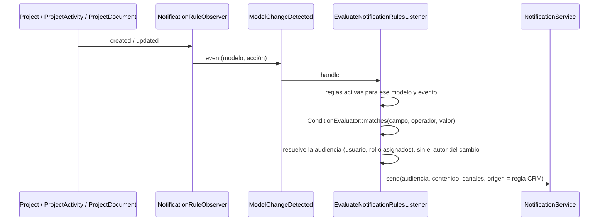

# Manual técnico — CRM

<!-- nav-manuales:inicio -->
> **Navegación:** [Índice de manuales](README.md) · ← [Ventas & Diseño](ventas-diseno.md) · [Servicios](servicios.md) →
> **Módulos relacionados:** [Ventas & Diseño](ventas-diseno.md)
<!-- nav-manuales:fin -->

> **Para quién:** un desarrollador que nunca ha tocado este módulo y necesita entenderlo y modificarlo con seguridad.
> **Base del manual:** backend `atlanticerp-backend` rama `dev` (commit `adf89308`, 2026-10-12) y frontend `atlanticerp-frontend` `origin/dev` (commit `95cc675`, 2026-10-12).
> **Cómo se verifica:** `python3 scripts/manual-coverage.py crm` comprueba que cada pieza del módulo esté nombrada aquí. Mide presencia, no calidad.
> **Documentos hermanos:** diagrama `docs/architecture/diagramas/crm.md`, ERD `docs/architecture/erd/crm.md`, API `docs/api/exports/openapi/crm.json`, spec de reglas de notificación `docs/specs/notifications.md`.

---

## 0. Lo primero que hay que saber: "CRM" significa dos cosas

En AtlanticERP la palabra **CRM** se usa para dos cosas distintas, y confundirlas es la forma más fácil de perder una tarde:

| | Qué es | Dónde vive |
|---|---|---|
| **El CRM original** | El módulo `App\Modules\CRM`: proyectos con asignados, actividades, recordatorios, documentos con versiones, enlaces compartidos, contactos, directorio, reportes y un motor de reglas de notificación. Es **este manual**. | `app/Modules/CRM/`, rutas `/api/crm/*`, esquema `{tenant}_crm`. |
| **El menú "CRM" de hoy** | La épica CRM (SCRUM-332): Dashboard CRM, Lista de Proyectos, Pipeline, Arquitectos, Catálogo. | Está construido **sobre Ventas & Diseño** (`PipelineCard`, `SalesProject`) y llama a los endpoints de `/api/ventas-diseno/*`, no a los de este módulo. |

Consecuencias prácticas, verificadas leyendo `origin/dev`:
- Las pantallas `/crm/dashboard` y `/crm/projects` llaman a `ventasDisenoApi` (`dashboard.summary`, `projects.list`, `projects.exportCsv`, `home.vendors`), **no** a `/api/crm/projects` ni a `/api/crm/dashboard`.
- Del lado del frontend, los clientes de API `contactsApi`, `directoryApi` y `reportsApi` **no tienen ningún consumidor** (ninguna pantalla los usa). Los componentes de la interfaz original (`ProjectModal`, `KanbanBoard`, `KpiGrid`, `AlertBanner`, `ProjectCard`) tampoco los importa ninguna pantalla viva, salvo entre ellos.
- Aun así el backend de este módulo **sigue en uso** por: el módulo de **IA** (resumir proyecto, sugerir acciones, redactar mensaje, análisis mensual leen `Project` y `ProjectAccess`), el **motor de reglas de notificación** (con su pantalla en Seguridad), los **umbrales de CRM** (`CrmSettingsService`, que también usa el Catálogo de Ventas & Diseño), la **exportación JSON**, el **autocompletado** y el **enlace público de documentos compartidos**.

> Si vas a arreglar algo que ves en pantalla bajo el menú CRM, probablemente tienes que ir al módulo Ventas & Diseño, no a este. Antes de tocar `/api/crm/*`, confirma con una búsqueda en el frontend y en los otros módulos quién lo llama (en el repositorio no hay otro consumidor, pero no se revisaron clientes externos).

---

## 1. Propósito y alcance

| Área | Qué resuelve | ¿Tiene interfaz hoy? |
|---|---|---|
| **Proyectos** | Registro de proyectos con etapa, tipo, fechas, valor, asignados. | No (la interfaz usa Ventas & Diseño). |
| **Actividades y recordatorios** | Historial de contactos con el cliente y tareas pendientes por proyecto. | No. |
| **Documentos** | Archivos por proyecto con categoría, versiones y zona pública o privada. | No. |
| **Enlaces compartidos** | Enlace público con vencimiento para un documento. | El enlace público sí funciona. |
| **Contactos y directorio** | Contactos gestionados y una vista derivada de los campos de los proyectos. | No. |
| **Dashboard y reportes** | KPIs, alertas y reportes mensuales y de equipo. | No (el Dashboard CRM visible es otro). |
| **Reglas de notificación** | Avisos por correo o en la aplicación cuando cambia un proyecto, una actividad o un documento. | Sí: `/security/notification-rules`. |
| **Umbrales** | Días de "entrega próxima" y de frescura de actividad, y límites del PDF de Catálogo. | Sí: dentro de la vista consolidada de superadmin. |
| **Exportación** | Volcado JSON de todo el CRM. | API solamente. |

**Quiénes lo usan.** `superadmin` y `management` ven todos los proyectos; el resto, solo los proyectos donde están asignados (ver 4.1).

---

## 2. Mapa del código

### 2.1 Backend (`atlanticerp-backend/app/Modules/CRM/`)

| Carpeta | Contenido |
|---|---|
| `Http/Controllers/` | 13 controladores. |
| `Http/Requests/` | 7 Form Requests. |
| `Models/` | 8 modelos. |
| `Services/` | 7 servicios. |
| `Events/` | 6 eventos (5 de dominio más `ModelChangeDetected`, interno). |
| `Listeners/` | 4 listeners. |
| `Notifications/` | `ConditionEvaluator` y `NotifiableModel` (lista permitida del motor de reglas). |
| `Observers/` | `NotificationRuleObserver`. |
| `Support/` | `ProjectAccess`. |

Fuera de la carpeta:

| Archivo | Para qué |
|---|---|
| `routes/crm.php` | Rutas `/api/crm/*` (montadas bajo `api/crm` en `bootstrap/app.php`). |
| `routes/admin.php` | Reglas de notificación (`/api/admin/notification-rules`) y exportación (`/api/admin/export/crm`). |
| `bootstrap/app.php` (línea ~49) | Ruta pública `GET /public/share/{token}`, **fuera** de `/api` y sin JWT. |
| `app/Providers/AppServiceProvider.php` | Registra listeners y el observador del motor de reglas sobre los tres modelos permitidos. |
| `app/Modules/AI/...` | Usa `Project` y `ProjectAccess`. |
| `app/Modules/VentasDiseno/...` | `CatalogController` y `CatalogPdfExportService` usan `CrmSettingsService`. |
| `tests/Feature/CRM/` | Pruebas. |

### 2.2 Frontend (`atlanticerp-frontend/src/`)

| Archivo | Estado |
|---|---|
| `pages/crm/DashboardPage.tsx` y `ProjectsListPage.tsx` | **Vivas**, pero llaman a Ventas & Diseño. |
| `pages/security/NotificationRulesPage.tsx` y `api/notificationRulesApi.ts` | **Vivas**: administración de reglas. |
| `components/CrmSettingsPanel.tsx` | **Vivo**: lo monta `GlobalSettingsPage`. |
| `api/projectsApi.ts` | Cliente de `/api/crm/*` (proyectos, actividades, recordatorios, documentos, enlaces, KPIs, ajustes). Solo lo importan componentes de la interfaz original, `CrmSettingsPanel` (ajustes) y `PipelineCardModal`. |
| `api/autocompleteApi.ts` | Vivo: lo usan `ContactoAutocomplete` y `RegistrarGastoCajaChicaModal` (Admin & Contabilidad). |
| `api/contactsApi.ts`, `api/directoryApi.ts`, `api/reportsApi.ts` | **Sin consumidores** en el frontend. |
| `components/ProjectModal`, `DocumentSection`, `ShareLinkModal`, `ActivityTimeline`, `ContactoAutocomplete` | Interfaz original; `ProjectModal` no la monta ninguna pantalla. |
| `components/KanbanBoard`, `ProjectCard`, `KpiGrid`, `AlertBanner` | Interfaz original; `KanbanBoard` y `KpiGrid` no los importa ninguna pantalla viva; `AlertBanner` tampoco. |
| `types/project.ts`, `types/reports.ts`, `types/directory.ts`, `utils/urgencyUtils.ts` | Tipos y utilidades de lo anterior. |

### 2.3 Cómo viaja una petición

```
Cliente → /api/crm/... (JWT, grupo `api`) → permission:crm.* (solo en escrituras) → Controller
        → validación (Form Request) → Service / Model → ProjectService emite eventos
        → listeners de log   ·   observer → ModelChangeDetected → motor de reglas → NotificationService
```

---

## 3. Modelo de datos

Esquema `{tenant}_crm`. ERD: `docs/architecture/erd/crm.md` (incluye también `ai_analyses`, que pertenece al módulo de IA).

| Tabla | Modelo | Qué guarda |
|---|---|---|
| `projects` | `Project` | Proyecto: `nombre`, contacto (`contacto`, `email`, `celular`), `encargado`, `developer`, `arquitecto`, `tipo`, `dialux`, `area`, `despacho`, `ubicacion`, `etapa`, `fecha_entrega`, `valor`, `notas`, `created_by`. |
| `project_assignees` | — (pivote de `Project::assignees()`) | Usuarios asignados; define quién ve el proyecto. |
| `project_activities` | `ProjectActivity` | Actividad: `tipo`, `fecha`, `notas`, `siguiente` (fecha de la próxima acción), `user_id`. |
| `project_reminders` | `ProjectReminder` | Recordatorio: `tipo`, `fecha`, `nota`, `completado`. |
| `project_documents` | `ProjectDocument` | Documento: `categoria`, `nombre_archivo`, `storage_key`, `size_bytes`, `mime_type`, `storage_zone` (`private` o `public`), `public_url`, `version`, `parent_document_id`, `is_current`, `uploaded_by`. |
| `share_links` | `ShareLink` | Enlace compartido: `token_hash` (SHA-256), `document_id`, `created_by`, `expires_at`, `revoked_at`, `last_accessed_at`, `access_count`. |
| `contacts` | `Contact` | Contacto gestionado: `nombre`, `tipo`, `email`, `telefono`, `empresa`, `notas`. |
| `notification_rules` | `NotificationRule` | Regla del motor de notificaciones. |
| `crm_settings` | `CrmSetting` | Umbrales configurables, clave y valor. |

### 3.1 Valores fijos de columnas

| Campo | Valores |
|---|---|
| `projects.etapa` | `lead`, `diseno`, `cotizacion`, `propuesta`, `cerrado`, `perdido`. Abiertas: las cuatro primeras. |
| `projects.tipo` | `diseno`, `cotizacion`, `ambos`. |
| `project_activities.tipo` | `llamada`, `email`, `reunion`, `whatsapp`, `visita`, `otro`. |
| `project_reminders.tipo` | `llamada`, `email`, `reunion`, `whatsapp`, `visita`, `cotizacion`, `diseno`, `otro`. |
| `project_documents.categoria` | `cotizacion`, `diseno`, `presentacion`, `plano`, `render`, `ficha`, `modelo_3d`, `otro`. |
| `contacts.tipo` | `developer`, `arquitecto`, `encargado`, `contacto`. |
| `notification_rules.trigger_type` | `model_event` (el tipo `date_proximity` está reservado y no se acepta todavía). |
| `notification_rules.operator` | `changed`, `changed_to`, `equals`, `gt`, `lt`, `gte`, `lte`. |
| `notification_rules.recipient_type` | `user`, `role`, `project_assignees`. |
| `notification_rules.channels` | `in_app`, `email`. |

**No hay máquina de estados para la etapa.** `changeStage` cambia la etapa a cualquiera de las seis permitidas, sin comprobar de dónde viene. Es una etapa del CRM original; **no es** la del pipeline de Ventas & Diseño.

### 3.2 Documentos con versiones
Al subir un documento de una categoría que ya tiene uno vigente en el proyecto, el anterior pasa a `is_current = false` y el nuevo recibe `version + 1` y `parent_document_id` apuntando al anterior. Hay una vista de historial (`documents/history`).

### 3.3 Migraciones
En `database/migrations/tenant/` con `TenantSchemaMigration` (`$module = 'crm'`). Toda migración nueva la revisa el Arquitecto.

---

## 4. Reglas de negocio y parámetros

### 4.1 Acceso a un proyecto
`superadmin` y `management` ven todos; el resto, solo los proyectos donde figura como asignado (`ProjectAccess::canAccess()`). La regla está **copiada** en los controladores (cada uno tiene su `canAccess()` privado) y centralizada en `ProjectAccess` para el módulo de IA (SCRUM-1056); migrar las copias es una limpieza pendiente. Las rutas de lectura (GET) no llevan middleware `permission:`: el acceso lo decide la asignación del proyecto.

### 4.2 Permisos de escritura
`crm.write` para crear, `crm.edit` para modificar y cambiar etapa, `crm.delete` para borrar. **Borrar un proyecto** exige además el rol `superadmin` o `management`. Reportes: `reports.read` y `reports.export`; el reporte de equipo exige también esos dos roles.

### 4.3 Umbrales (`crm_settings`)
Editables en `PUT /crm/settings` (solo `superadmin.all`), validados por `CrmSettingsRequest`. Sin fila, `CrmSettingsService` usa el valor por defecto.

| Clave interna (nombre en la API) | Defecto | Rango | Para qué |
|---|---|---|---|
| `entrega_proxima_dias` | 3 | 1–365 | Un proyecto abierto con entrega dentro de N días cuenta como "próximo". |
| `freshness_recent_dias` | 7 | 1–365 | Actividad en los últimos N días = "reciente". |
| `freshness_stale_dias` | 21 | 1–365 | Sin actividad hace más de N días = "frío". |
| `catalog_pdf_max_single_products` | 500 | 1–1000 | Máximo de productos del PDF plano de Catálogo. |
| `catalog_pdf_max_single_photos` | 200 | 1–500 | Máximo de productos con foto en el PDF plano. |
| `catalog_pdf_volume_size` | 500 | 50–1000 | Productos por volumen del ZIP en segundo plano. |
| `catalog_pdf_export_retention_days` | 7 | 1–90 | Días que se conserva un ZIP de catálogo. |

Los cuatro últimos pertenecen al **Catálogo de Ventas & Diseño**, no al CRM; están aquí por historia (SCRUM-998).

### 4.4 Alertas y frescura
- Alertas del dashboard (`DashboardService`): vencidos (entrega pasada), próximos (entrega en los próximos `entrega_proxima_dias`) y fríos (sin actividad en `freshness_stale_dias`), siempre sobre proyectos **abiertos**. Devuelve el detalle de cada proyecto afectado y los correos de los usuarios `management`, para que el frontend arme un `mailto:` (no hay envío de correo en el servidor).
- **Incongruencia conocida:** `ProjectService::getUrgency()` y `getFreshness()` — que alimentan los campos `urgency` y `freshness` que devuelve cada proyecto — usan **valores fijos** (3 días; 7 y 21 días) y **no leen** `crm_settings`, aunque los filtros de la lista y el dashboard sí. Cambiar el umbral en Configuración no cambia esas etiquetas.

### 4.5 Documentos y enlaces compartidos
- Subida: máximo de tamaño tomado de la configuración global `documents.max_size_mb` (500 por defecto, en caché 5 minutos) y extensiones permitidas en `DocumentController::ALLOWED_MIMES` (documentos de oficina, imágenes, comprimidos, CAD/BIM como `dwg`, `dxf`, `rvt` y 3D como `obj`, `fbx`, `glb`, `gltf`, `blend`, `skp`, `ma`, `mb`). La regla es por **extensión**, no por tipo MIME.
- Zona `private` (por defecto): disco `s3-private`, descarga con URL prefirmada de 15 minutos. Zona `public`: disco `s3-public`, URL pública permanente.
- El almacenamiento va protegido con `CircuitBreaker`; si el registro en base falla tras subir el archivo, se borra el archivo.
- **Enlace compartido:** el token en claro solo existe en la respuesta de creación (`POST .../share-links`); se guarda su SHA-256. Vence según la configuración global `share_links_expiration_days` (30 días por defecto). Se revoca por **id** (`DELETE /crm/share-links/{id}`), no por token. El acceso público (`/public/share/{token}`) resuelve el tenant desde la petición, redirige al documento, suma el contador de accesos y limita a 30 peticiones por minuto. Crear un enlace deja una acción de auditoría.

### 4.6 Contactos
Un contacto no se puede borrar (409) si tiene proyectos activos vinculados por nombre y tipo. `POST /crm/contacts/import` crea contactos a partir de los nombres que aparecen en los campos de los proyectos y rellena correo y teléfono vacíos desde un proyecto que los tenga.

### 4.7 Reportes
- **Mensual** (`reports/monthly`, parámetro `month` `AAAA-MM`): proyectos nuevos, cerrados y perdidos del mes, **tasa de cierre** = cerrados ÷ (cerrados + perdidos), actividades por tipo. `management` y `superadmin` pueden filtrar por varios usuarios; el resto ve solo lo suyo.
- **Exportación CSV** del reporte mensual: `reports/monthly/export`.
- **Equipo** (`reports/team`): solo `superadmin` y `management`.

---

## 5. Flujos principales

### 5.1 Motor de reglas de notificación



- **Lista permitida (`NotifiableModel::REGISTRY`):** solo `Project` (campos `etapa`, `valor`, `fecha_entrega`, `area`, `despacho`), `ProjectActivity` (`tipo`) y `ProjectDocument` (`categoria`). El observador se registra únicamente sobre esos tres modelos, nunca global. Existe por seguridad (que una regla no apunte a tablas sensibles) y por rendimiento.
- **Audiencia:** `user` (ids), `role` (roles) o `project_assignees`. El autor del cambio nunca se notifica a sí mismo.
- Solo se aceptan reglas de tipo `model_event`; las de proximidad de fecha están previstas pero no implementadas.
- Para agregar un modelo nuevo: una entrada en `NotifiableModel::REGISTRY` más su observador; las reglas sobre modelos ya permitidos no requieren código.

### 5.2 Crear un proyecto
`ProjectService::create` crea el proyecto y sus asignados dentro de una transacción y emite `ProjectCreated`. Cambiar la etapa emite `ProjectStageChanged`; agregar una actividad emite `ActivityAdded`.

---
## 6. API

Rutas bajo `/api/crm` generadas con `scripts/manual-routes-table.py crm` (39 rutas, 2026-10-12), más las tres piezas que viven fuera de `/api/crm`. Documentación interactiva de dev: `https://dev.atlanticerp.ai/docs/api`; colección de Postman: `docs/api/exports/postman/crm.postman_collection.json`.

> **Recuerda** (sección 0): ninguna pantalla viva llama a estas rutas salvo reglas de notificación, ajustes, autocompletado y el enlace público. Las demás tienen pruebas y funcionan, pero no tienen interfaz.


**`/crm/autocomplete`**

| Método | Ruta | Controlador@método | Permiso (OR) |
|---|---|---|---|
| GET | `/crm/autocomplete/contacts` | `AutocompleteController@contacts` | `(la comprueba el controlador)` |
| GET | `/crm/autocomplete/fields` | `AutocompleteController@fields` | `(la comprueba el controlador)` |
| GET | `/crm/autocomplete/users` | `AutocompleteController@users` | `(la comprueba el controlador)` |

**`/crm/contacts`**

| Método | Ruta | Controlador@método | Permiso (OR) |
|---|---|---|---|
| GET | `/crm/contacts` | `ContactController@index` | `(la comprueba el controlador)` |
| POST | `/crm/contacts` | `ContactController@store` | `crm.write` |
| POST | `/crm/contacts/import` | `ContactController@import` | `crm.write` |
| PUT | `/crm/contacts/{id}` | `ContactController@update` | `crm.edit` |
| DELETE | `/crm/contacts/{id}` | `ContactController@destroy` | `crm.delete` |

**`/crm/dashboard`**

| Método | Ruta | Controlador@método | Permiso (OR) |
|---|---|---|---|
| GET | `/crm/dashboard/kpis` | `DashboardController@kpis` | `(la comprueba el controlador)` |
| GET | `/crm/dashboard/reminders` | `DashboardController@reminders` | `(la comprueba el controlador)` |

**`/crm/directory`**

| Método | Ruta | Controlador@método | Permiso (OR) |
|---|---|---|---|
| GET | `/crm/directory` | `DirectoryController@index` | `(la comprueba el controlador)` |

**`/crm/documents`**

| Método | Ruta | Controlador@método | Permiso (OR) |
|---|---|---|---|
| DELETE | `/crm/documents/{documentId}` | `DocumentController@destroy` | `crm.delete` |
| GET | `/crm/documents/{documentId}/url` | `DocumentController@url` | `(la comprueba el controlador)` |

**`/crm/projects`**

| Método | Ruta | Controlador@método | Permiso (OR) |
|---|---|---|---|
| GET | `/crm/projects` | `ProjectController@index` | `(la comprueba el controlador)` |
| POST | `/crm/projects` | `ProjectController@store` | `crm.write` |
| GET | `/crm/projects/{id}` | `ProjectController@show` | `(la comprueba el controlador)` |
| PUT | `/crm/projects/{id}` | `ProjectController@update` | `crm.edit` |
| DELETE | `/crm/projects/{id}` | `ProjectController@destroy` | `crm.delete` |
| PATCH | `/crm/projects/{id}/stage` | `ProjectController@changeStage` | `crm.edit` |
| GET | `/crm/projects/{projectId}/activities` | `ActivityController@index` | `(la comprueba el controlador)` |
| POST | `/crm/projects/{projectId}/activities` | `ActivityController@store` | `crm.write` |
| DELETE | `/crm/projects/{projectId}/activities/{actId}` | `ActivityController@destroy` | `crm.delete` |
| GET | `/crm/projects/{projectId}/documents` | `DocumentController@index` | `(la comprueba el controlador)` |
| POST | `/crm/projects/{projectId}/documents` | `DocumentController@store` | `crm.write` |
| GET | `/crm/projects/{projectId}/documents/history` | `DocumentController@history` | `(la comprueba el controlador)` |
| DELETE | `/crm/projects/{projectId}/documents/{documentId}` | `DocumentController@destroy` | `crm.delete` |
| GET | `/crm/projects/{projectId}/documents/{documentId}/download` | `DocumentController@download` | `(la comprueba el controlador)` |
| GET | `/crm/projects/{projectId}/documents/{documentId}/share-links` | `ShareLinkController@index` | `(la comprueba el controlador)` |
| POST | `/crm/projects/{projectId}/documents/{documentId}/share-links` | `ShareLinkController@store` | `crm.write` |
| GET | `/crm/projects/{projectId}/reminders` | `ReminderController@index` | `(la comprueba el controlador)` |
| POST | `/crm/projects/{projectId}/reminders` | `ReminderController@store` | `crm.write` |
| DELETE | `/crm/projects/{projectId}/reminders/{remId}` | `ReminderController@destroy` | `crm.delete` |
| PATCH | `/crm/projects/{projectId}/reminders/{remId}/toggle` | `ReminderController@toggle` | `crm.edit` |

**`/crm/reports`**

| Método | Ruta | Controlador@método | Permiso (OR) |
|---|---|---|---|
| GET | `/crm/reports/monthly` | `ReportsController@monthly` | `reports.read` |
| GET | `/crm/reports/monthly/export` | `ReportsController@export` | `reports.export` |
| GET | `/crm/reports/team` | `ReportsController@team` | `reports.read` |

**`/crm/settings`**

| Método | Ruta | Controlador@método | Permiso (OR) |
|---|---|---|---|
| GET | `/crm/settings` | `CrmSettingsController@show` | `superadmin.all` |
| PUT | `/crm/settings` | `CrmSettingsController@update` | `superadmin.all` |

**`/crm/share-links`**

| Método | Ruta | Controlador@método | Permiso (OR) |
|---|---|---|---|
| DELETE | `/crm/share-links/{id}` | `ShareLinkController@revoke` | `crm.delete` |

**Fuera de `/api/crm`**

| Método | Ruta | Controlador@método | Permiso o gate |
|---|---|---|---|
| GET | `/admin/notification-rules` | `NotificationRuleController@index` | `permission:superadmin.all` |
| POST | `/admin/notification-rules` | `NotificationRuleController@store` | `permission:superadmin.all` |
| PUT | `/admin/notification-rules/{id}` | `NotificationRuleController@update` | `permission:superadmin.all` |
| DELETE | `/admin/notification-rules/{id}` | `NotificationRuleController@destroy` | `permission:superadmin.all` |
| GET | `/admin/export/crm` | `CrmExportController` (invocable) | `permission:superadmin.all` |
| GET | `/public/share/{token}` | `ShareLinkController@publicAccess` | sin JWT; `throttle:30,1` |

> **Nombres de parámetros.** En el OpenAPI y en Postman algunos parámetros de ruta pueden aparecer con otro nombre; es la misma ruta.

### 6.1 Notas
- **Documentos:** existen dos rutas de borrado, una anidada en el proyecto y otra por id suelto (`/crm/documents/{documentId}`); lo mismo con la URL de descarga (`/crm/documents/{documentId}/url` y `.../documents/{documentId}/download`).
- **Listado de proyectos:** filtros `search` (nombre, contacto o encargado), `etapa`, `tipo`, `area`, `despacho`, `ubicacion`, `urgency` (`vencido` o `proximo`), `freshness` (`recent`, `stale`, `cold`), `dialux`, `user_id`/`user_ids` y `per_page`. Pagina con la política global del backend.
- **Autocompletado:** `fields` (valores ya usados en un campo de proyecto), `users` y `contacts`.
- **Exportación JSON** (`/admin/export/crm`): descarga proyectos con actividades, recordatorios y asignados, y todos los contactos, del tenant actual.
- **`DELETE` de proyectos** devuelve 403 a quien no sea `superadmin` o `management`, aunque tenga `crm.delete`.

### 6.2 Validaciones
| Form Request | Reglas relevantes |
|---|---|
| `StoreProjectRequest` | `nombre` (255) y `tipo` obligatorios; `etapa` en las seis válidas; correo válido; `valor` ≥ 0; `assignee_ids` existentes. |
| `UpdateProjectRequest` | Las mismas, todas opcionales. |
| `StoreActivityRequest` | `tipo` (6 valores), `fecha`, `notas` opcional, `siguiente` opcional y **no anterior a hoy**. |
| `StoreReminderRequest` | `tipo` (8 valores), `fecha`, `nota` opcional. |
| `StoreNotificationRuleRequest` y `UpdateNotificationRuleRequest` | `name` (150), `trigger_type` solo `model_event`, `trigger_model` en la lista permitida, `trigger_event` `created` o `updated`, `operator` obligatorio si hay `field`, al menos un canal, `recipient_value` obligatorio salvo `project_assignees`. |
| `CrmSettingsRequest` | Rangos de 4.3 (`min:1`, nunca 0). |

Los contactos, la subida de documentos y las peticiones de reporte se validan dentro del controlador (`Contact::ALLOWED_TYPES`, extensiones y categoría para documentos).

---

## 7. Permisos, roles y acceso

| Qué | Quién |
|---|---|
| Leer un proyecto y sus anexos | `superadmin`, `management`, o asignado al proyecto |
| Crear, editar, borrar | `crm.write`, `crm.edit`, `crm.delete` |
| Borrar un proyecto | además `superadmin` o `management` |
| Reportes | `reports.read`; exportar `reports.export`; equipo solo `superadmin` o `management` |
| Umbrales, reglas de notificación, exportación JSON | `superadmin.all` |
| Enlace público de documento | cualquiera con el token válido |

**Trampa v1/v2:** igual que en los otros módulos, los permisos del JWT pueden diferir de `hasPermission()`. Los chequeos de rol de este módulo usan el rol activo (`activeRole`).

**Frontend:** `/crm/dashboard` y `/crm/projects` exigen `ventas_diseno.read` (no `crm.*`); `/security/notification-rules` y `/configuracion/global` exigen `superadmin.all`.

---

## 8. Frontend

| Ruta | Página | Permiso | Qué hace |
|---|---|---|---|
| `/crm` | redirección | — | Lleva al Pipeline de Ventas & Diseño. |
| `/crm/dashboard` | `pages/crm/DashboardPage` | `ventas_diseno.read` | Dashboard CRM con gráficos (`chart.js`), filtro por usuarios y alertas; datos de `ventasDisenoApi`. |
| `/crm/projects` | `pages/crm/ProjectsListPage` | `ventas_diseno.read` | Lista de proyectos paginada desde el servidor, con filtros y exportación CSV; datos de `ventasDisenoApi`. |
| `/security/notification-rules` | `pages/security/NotificationRulesPage` | `superadmin.all` | Alta, edición y borrado de reglas; la lista devuelve también un `registry` con los modelos, campos y operadores permitidos. |
| `/configuracion/global` | `GlobalSettingsPage` (monta `CrmSettingsPanel`) | `superadmin.all` | Umbrales de CRM junto con los de los demás módulos. |

La interfaz original del CRM (componentes sin pantalla viva, ver 2.2) trabaja sobre `projectsApi`. Si decides reactivarla o borrarla, recuerda que `ProjectModal` arrastra `DocumentSection`, `ShareLinkModal`, `ActivityTimeline` y `ContactoAutocomplete`.

**Patrones:** TanStack Query, `Pagination` del servidor, `UserMultiSelect` para filtros, textos con i18n en español e inglés.

---

## 9. Eventos, jobs e integraciones

### 9.1 Eventos y listeners

| Evento | Nombre | Lo emite | Listener |
|---|---|---|---|
| `ProjectCreated` | `crm.project.created` | `ProjectService::create` | `LogProjectCreated` |
| `ProjectStageChanged` | `crm.project.stage-changed` | `ProjectService::changeStage` | `LogProjectStageChanged` |
| `ActivityAdded` | `crm.project.activity-added` | `ActivityController` vía `ProjectService::dispatchActivityAdded` | `LogActivityAdded` |
| `DocumentUploaded` | `crm.document.uploaded` | `DocumentService::upload` | ninguno |
| `DocumentDeleted` | `crm.document.deleted` | `DocumentService::delete` | ninguno |
| `ModelChangeDetected` | (interno, no implementa `DomainEvent`) | `NotificationRuleObserver` | `EvaluateNotificationRulesListener` |

Los tres `Log*` solo escriben el evento en el registro (`Log::info`). Sin jobs ni correos propios: los avisos de las reglas los envía el módulo `Notifications` (`NotificationService`, origen "regla CRM").

### 9.2 Servicios

| Servicio | Responsabilidad |
|---|---|
| `ProjectService` | Listado con filtros, alta, edición, cambio de etapa, borrado, urgencia y frescura. |
| `DocumentService` | Subida con versiones, URL prefirmadas, borrado y URL de enlace compartible. |
| `DashboardService` | KPIs por etapa y tipo, pipeline activo y cerrado, alertas y recordatorios. |
| `ReportsService` | Reporte mensual y de equipo. |
| `DirectoryService` | Directorio derivado de los campos de los proyectos (developer, arquitecto, encargado, contacto). |
| `ContactService` | Contactos, borrado con conteo de proyectos activos e importación. |
| `CrmSettingsService` | Lectura y escritura de los umbrales. |

### 9.3 Integraciones
- **IA:** `SummarizeProjectJob`, `SuggestActionsJob`, `DraftMessageJob` y `MonthlyAnalysisJob` leen proyectos del CRM; `AIController` aplica `ProjectAccess`.
- **Notificaciones:** `NotificationService`, con canales `in_app` y `email`.
- **Auditoría:** `AuditService` (`CRM_SHARE_LINK_CREATED`) y el trait `LogsAuditTrail`.
- **Ventas & Diseño:** `CrmSettingsService` para el Catálogo.
- **Almacenamiento:** S3 privado y público.

---

## 10. Configuración y datos semilla
- Variables propias: ninguna. El tamaño máximo de documento (`documents.max_size_mb`) y la vigencia de enlaces (`share_links_expiration_days`) son configuraciones **globales** del sistema, fuera de este módulo.
- Sin seeders propios de CRM en producción; los proyectos demostrativos viven en seeders de demo de otros módulos (solo local, dev y testing).
- Los umbrales sin fila usan los valores por defecto de 4.3.

---

## 11. Pruebas
- **Backend:** `infra/test.sh --filter=<Clase>`. Nunca `docker compose exec laravel php artisan test` directo.
- **Clases (`tests/Feature/CRM/`):** `ProjectControllerTest`, `ActivityControllerTest`, `ReminderControllerTest`, `DocumentControllerTest`, `ShareLinkControllerTest`, `ContactControllerTest`, `DirectoryControllerTest`, `DashboardControllerTest`, `ReportControllerTest`, `AutocompleteControllerTest`, `CrmSettingsControllerTest`, `NotificationRuleControllerTest` y `NotificationRuleEngineTest` (el motor).
- **Frontend:** `npx vitest run`; hay `src/pages/crm/DashboardPage.test.tsx`. Nunca `npm test` a secas.
- **Playwright:** `e2e/preqa-scrum684-689-dashboard-crm-batchc.spec.ts` y `e2e/preqa-scrum690-694-crm-listaproyectos-20260731.spec.ts` (las dos pantallas vivas).
- **Gate antes de un push:** `infra/gate.sh`.

---

## 12. Recetas para modificar el módulo

Antes de empezar: ¿lo que quieres cambiar está en la pantalla viva (Ventas & Diseño) o en este módulo? Ver sección 0.

### 12.1 Agregar una regla de notificación sobre un campo nuevo
1. Añade el campo a `NotifiableModel::REGISTRY` para su modelo (el `registry` que devuelve la API lo mostrará solo en la pantalla).
2. Si el campo exige un operador nuevo, agrégalo en `NotificationRule::OPERATORS`, en `ConditionEvaluator` y en `notificationRulesApi.ts`.
3. Prueba en `NotificationRuleEngineTest`.

### 12.2 Permitir otro modelo como origen de reglas
Entrada en `NotifiableModel::REGISTRY` más su observador registrado en `AppServiceProvider` y un caso en `EvaluateNotificationRulesListener::resolveProject` (o equivalente) para resolver la audiencia. Revisión de Cybersecurity: la lista permitida evita fugas de datos sensibles.

### 12.3 Agregar un umbral
Clave y valor por defecto en `CrmSettingsService`, lectura, entrada en `allSettings()` y `updateSettings()`, regla en `CrmSettingsRequest`, campo en `CrmSettingsPanel`. **Usa el servicio también en `getUrgency` y `getFreshness`**, que hoy no lo hacen (ver 13).

### 12.4 Agregar un campo al proyecto
Migración, `$fillable` y `casts()` de `Project`, `StoreProjectRequest` y `UpdateProjectRequest`, la lista de campos de `ProjectService::update`, el formato de salida del controlador, tipos del frontend (`types/project.ts`), y las pruebas. Decide si debe entrar a `NotifiableModel`.

### 12.5 Cambiar los tipos permitidos de un valor fijo
Las listas (etapas, tipos de actividad y de recordatorio, categorías de documento) están repetidas en el Form Request, el controlador y el frontend; cámbialas en todos esos sitios y en la base si hay restricciones.

### 12.6 Retirar o reactivar la interfaz original
Ver 8. Antes de borrar `/api/crm/*`, confirma que el módulo de IA, el motor de reglas y los umbrales ya no las necesitan, y que ningún cliente externo las usa.

---

## 13. Problemas conocidos y deuda

**Backend con poca interfaz.** Las rutas de proyectos, actividades, recordatorios, documentos, enlaces, contactos, directorio, dashboard y reportes de `/api/crm` no tienen consumidor en el frontend actual. Hay que decidir si se retiran, se reactivan o se migran a Ventas & Diseño.

**Valores fijos que contradicen la parametrización.** `ProjectService::getUrgency()` (3 días) y `getFreshness()` (7 y 21 días) ignoran `crm_settings`; los filtros y el dashboard sí la leen. Un cambio en Configuración deja las etiquetas `urgency` y `freshness` desfasadas.

**Duplicación de la regla de acceso.** Cada controlador tiene su `canAccess()` propio; solo el módulo de IA usa `ProjectAccess`.

**Ajustes de Catálogo en el CRM.** Cuatro de los siete umbrales son del Catálogo de Ventas & Diseño.

**Sin validación de transiciones.** `changeStage` acepta cualquier etapa válida desde cualquier otra.

**Valores fijos en la base.** `etapa` y `tipo` se restringen en los Form Requests; no se revisó si la base tiene además una restricción.

**Reglas de notificación a medias.** Solo existe `model_event`; `date_proximity` está reservada en el modelo y los tipos del frontend pero la API la rechaza.

**Trampas de implementación**
- Una escritura en `Project`, `ProjectActivity` o `ProjectDocument` dispara el observador y el motor de reglas; las operaciones masivas por consulta (`update()` de Eloquent en bloque) **no** disparan eventos de modelo.
- El enlace público resuelve el tenant desde la petición; si cambias cómo se resuelve el tenant, prueba ese camino.
- Los permisos v1/v2 pueden diferir; los roles se evalúan con el rol activo.
- El frontend local puede estar desfasado respecto a `origin/dev`.

---

## 14. Glosario

| Término | Significado |
|---|---|
| **Etapa** | Estado de un proyecto del CRM original (`lead` a `perdido`); distinto de la etapa del pipeline de Ventas & Diseño. |
| **Pipeline activo / cerrado** | Suma de `valor` de proyectos abiertos / cerrados. |
| **Entrega próxima** | Proyecto abierto con `fecha_entrega` dentro de N días. |
| **Reciente / frío** | Actividad en los últimos 7 días / sin actividad en 21 (valores por defecto). |
| **Zona (documento)** | `private` (URL prefirmada) o `public` (URL permanente). |
| **Enlace compartido** | URL pública con token de un solo uso de creación y vencimiento. |
| **Regla de notificación** | Condición sobre un cambio de modelo que dispara un aviso a una audiencia. |
| **Lista permitida** | `NotifiableModel::REGISTRY`: modelos y campos que una regla puede observar. |
| **ProjectAccess** | Regla centralizada de acceso a un proyecto. |

<!-- nav-manuales:inicio -->
---
**Navegación:** [Índice de manuales](README.md) · ← [Ventas & Diseño](ventas-diseno.md) · [Servicios](servicios.md) →
<!-- nav-manuales:fin -->
