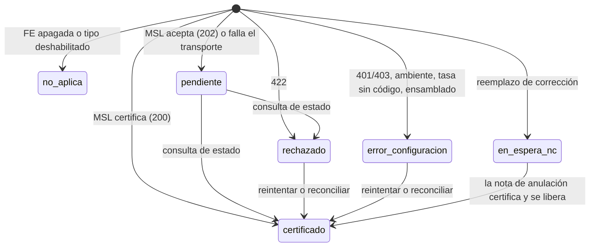
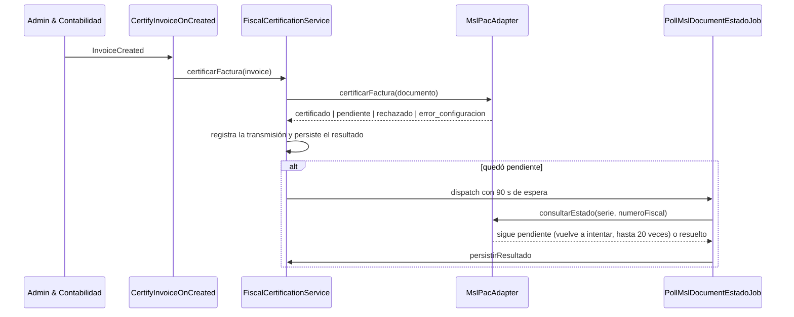

# Manual técnico — Factura Electrónica

<!-- nav-manuales:inicio -->
> **Navegación:** [Índice de manuales](README.md) · ← [Admin & Contabilidad](admin-contabilidad.md) · [Gerencia](gerencia.md) →
> **Módulos relacionados:** [Admin & Contabilidad](admin-contabilidad.md) · [Ventas & Diseño](ventas-diseno.md)
<!-- nav-manuales:fin -->

> **Para quién:** un desarrollador que nunca ha tocado este módulo y necesita entenderlo y modificarlo con seguridad.
> **Advertencia:** este módulo emite documentos fiscales ante la DGI de Panamá. Un error aquí no es un error de pantalla: puede dejar un documento fiscal inmutable que no cuadra con lo cobrado. Léelo entero antes de tocar nada, y no hagas pruebas contra producción de MSL.
> **Base del manual:** backend `atlanticerp-backend` rama `dev` (commit `78ebc513`, 2026-10-12) y frontend `atlanticerp-frontend` `origin/dev` (commit `95cc675`, 2026-10-12).
> **Cómo se verifica:** `python3 scripts/manual-coverage.py factura-electronica` comprueba que cada pieza esté nombrada aquí. Mide presencia, no calidad.
> **Documentos hermanos:** `docs/architecture/facturacion-electronica-conocimiento.md` (base de conocimiento fiscal), `facturacion-electronica-pac-diseno.md` (diseño), `docs/security/THREAT-MODEL-facturacion-electronica-msl.md`, diagrama `docs/architecture/diagramas/factura-electronica.md`, ERD `docs/architecture/erd/factura-electronica.md` (compartido con Admin & Contabilidad) y los specs `docs/specs/scrum-1007-recertificar-documentos-fe.md` y `docs/specs/guarda-validacion-ruc-al-facturar.md`.

---

## 1. Propósito y alcance

Factura Electrónica certifica ante la DGI (Dirección General de Ingresos) cada **factura** y cada **nota de crédito** que AtlanticERP genera, a través de un proveedor autorizado (PAC). Atlantic factura unos 527 documentos al mes y la Resolución 201-6299 obliga a la facturación electrónica por encima de 100.

| Elemento | Decisión vigente |
|---|---|
| **Proveedor** | **MSL** (intermediario que certifica con Digifact; `fedigifact.appmsl.com`). Decisión del cliente, épica SCRUM-941. |
| **Plan B** | Digifact directo (`DigifactPacAdapter`, `NucJsonMapper`): existe, **no está conectado**. Solo se retoma con decisión explícita de Luis. |
| **Regla de oro** | Un problema de facturación electrónica **nunca** bloquea ni revierte la factura ya creada en AtlanticERP. La certificación es un efecto secundario de mejor esfuerzo. |

**Qué hace este módulo:**
- Arma el documento fiscal (emisor, receptor, ítems, pagos, referencia) y lo certifica.
- Guarda el resultado (CUFE, QR, XML firmado) y un historial inmutable de cada transmisión.
- Reintenta, consulta y reconcilia documentos pendientes o rechazados (acciones manuales de Aprobador).
- Valida el RUC de los clientes contra la DGI y bloquea facturar a un receptor cuyos datos no coinciden.
- Previsualiza el JSON que se enviaría, sin enviarlo.

**Qué no hace:** crear facturas (eso es Admin & Contabilidad), cobrar, ni emitir notas de débito (AtlanticERP no las modela). El módulo vive dentro de `AdminCont` (`App\Modules\AdminCont\FacturacionElectronica`) pero tiene su propio manual por su sensibilidad.

---

## 2. Mapa del código

### 2.1 Backend

**Capa de FE** (`app/Modules/AdminCont/FacturacionElectronica/`) — es deliberadamente **independiente del modelo de facturación de AtlanticERP**: salvo `FiscalDocumentItemsBuilder` y `FiscalDocumentBuilder`, nada aquí conoce `AdminContInvoice`.

| Carpeta | Contenido |
|---|---|
| `Contracts/PacProviderContract.php` | El puerto: `providerName`, `certificarFactura`, `certificarNotaCredito`, `consultarEstado`, `validarReceptor`. |
| `Adapters/Msl/` | `MslPacAdapter` (proveedor real), `MslPaymentMethodMapper` (forma de pago interna a código MSL) y `PollMslDocumentEstadoJob` (consulta de estado). |
| `Adapters/DigifactPacAdapter.php` | Plan B, sin conectar. |
| `Mappers/` | `MslJsonMapper` (JSON exacto que espera MSL) y `NucJsonMapper` (Digifact). |
| `DTOs/` | `FiscalDocument`, `FiscalDocumentItem`, `FiscalDocumentReference`, `FiscalDocumentResult`, `FiscalParty`, `FiscalPartyLookupResult`, `FiscalPayment`. |
| `Services/` | 11 servicios (ver 9.3). |
| `Listeners/CertifyInvoiceOnCreated.php` | Certifica cuando se crea una factura. |
| `Exceptions/` | 5 excepciones (ver 9.4). |

**Piezas de FE fuera de esa carpeta:**

| Archivo | Para qué |
|---|---|
| `Http/Controllers/AdminContFiscalSettingsController.php` | Configuración Fiscal (solo Aprobador). |
| `Http/Controllers/AdminContFeReintentoController.php` | Reintentar, actualizar estado y reconciliar. |
| `Http/Controllers/AdminContFeTransmisionController.php` | Historial de transmisiones. |
| `Http/Controllers/AdminContInvoiceReceptorController.php` | Corregir el receptor desde la vista previa de la factura. |
| `Http/Controllers/AdminContInvoiceController.php` y `AdminContCreditNoteController.php` | Método `fePreview` y datos de FE en el detalle. |
| `VentasDiseno/Http/Controllers/ClientTaxDataController.php` | Validar RUC y editar datos fiscales de un subcliente. |
| `Models/AdminContFiscalSettings.php`, `AdminContFeTransmision.php`, `AdminContCompanyProfile.php` | Modelos. |
| `Http/Requests/UpdateFiscalSettingsRequest.php`, `CorrectInvoiceReceptorRequest.php`, y en Ventas & Diseño `ValidateTaxIdRequest.php`, `UpdateSubClientTaxDataRequest.php` | Validaciones. |
| `Http/Middleware/EnsureIsPrimaryApprover.php` | Alias de ruta `primary_approver_only`. |
| `app/Console/Commands/AdminContSetPacProviderCommand.php`, `ClientsRevalidateTaxIdsCommand.php` | Comandos. |
| `database/seeders/AdminContFiscalIdentitySeeder.php` | Datos de la empresa. |
| `config/services.php` (claves `msl_fe` y `digifact`) | Credenciales y URL. |

También intervienen `CreditNoteService` (certifica la nota al aplicarla), `InvoiceService` y `AppServiceProvider` (listeners y limitadores `fe-accion` y `tax-lookup`).

### 2.2 Frontend (`atlanticerp-frontend/src/`)

| Archivo | Para qué |
|---|---|
| `components/FiscalSettingsPanel.tsx` y `pages/admin-contab/FiscalConfigPage.tsx` | Pantalla Configuración Fiscal (la página solo monta el panel). |
| `components/admin-contab/FiscalElectronicStatusBadge.tsx` | Insignia del estado fiscal, compartida entre facturas y notas de crédito. |
| `components/admin-contab/ReceptorGuardNotice.tsx` | Aviso de la guarda de RUC al facturar. |
| `components/admin-contab/InvoiceDetailModal.tsx` y `DetalleNotaCreditoModal.tsx` | Muestran el estado de FE y las acciones. |
| `components/TaxIdValidator.tsx` y `components/EditSubClientTaxDataModal.tsx` | Validar RUC y editar datos fiscales. |
| `pages/admin-contab/ClientesFiscalPage.tsx` | Pantalla de datos fiscales de clientes para Aprobador y Contabilidad. |
| `api/adminContabApi.ts`, `api/ventasDisenoApi.ts`, `hooks/useAdminContab.ts`, `types/adminContab.ts` | Capa de datos y tipos (contienen otras funciones de Admin & Contabilidad; aquí solo las de FE). |

### 2.3 Cómo viaja una factura

```
Crear factura (Admin & Contabilidad) ──InvoiceCreated──▶ CertifyInvoiceOnCreated (síncrono)
  → FiscalCertificationService::certificarFactura
      → debeCertificar? (pac_ambiente ≠ apagado y el tipo está habilitado)
      → FiscalDocumentBuilder::paraFactura  (+ FiscalDocumentItemsBuilder, SerieResolver, ItbmsCodeMapper)
      → PacProviderFactory::make → MslPacAdapter → MslJsonMapper → POST a MSL
      → FeTransmisionRecorder (historial)  →  persistirResultado (fe_estado, cufe, qr, xml)
      → si quedó pendiente: PollMslDocumentEstadoJob (90 s después)
```

---

## 3. Modelo de datos

Factura Electrónica **no tiene esquema propio**: usa el de Admin & Contabilidad (`{tenant}_admin_contab`). ERD: `docs/architecture/erd/factura-electronica.md`.

| Tabla | Modelo | Qué guarda |
|---|---|---|
| `fiscal_settings` | `AdminContFiscalSettings` | **Fila única** de Configuración Fiscal. Identidad fiscal (razón social, RUC, DV, dirección, contacto, régimen), PAC (`pac_provider`, `pac_ambiente`, `pac_connection_status`, `pac_last_sync_at`, `pac_doc_factura_habilitado`, `pac_doc_nota_credito_habilitado`, `serie_fiscal`, `fe_reintento_max_horas`) y otros parámetros de Admin & Contabilidad. |
| `fe_transmisiones` | `AdminContFeTransmision` | **Historial inmutable** (solo se agrega): cada envío o consulta al PAC con el cuerpo enviado, la respuesta, el HTTP, la duración y el origen. Es evidencia fiscal y contiene datos del receptor (RUC, nombre, correo). |
| `company_profile` | `AdminContCompanyProfile` | Fila única de Datos de la Empresa (logo, descripción, redes, moneda, año fiscal, zona horaria). |
| `itbms_rates` | — | Tasas de ITBMS (0, 7, 10, 15 % y otras) que `ItbmsCodeMapper` traduce a códigos de la DGI. |
| `invoices` y `credit_notes` | `AdminContInvoice`, `AdminContCreditNote` | Llevan las columnas de FE: `serie`, `fe_estado`, `fe_detalle`, `cufe`, `qr_content`, `xml_firmado_path`, `pac_provider_usado`, `fe_emision_at`, `fe_certificado_at`. Únicos por (`serie`, `numero`). `invoices` suma el receptor congelado (`receptor_*`, SCRUM-1140). |

**Quién escribe qué.** `FiscalCertificationService` es el **único** que escribe `serie`, `fe_estado`, `fe_detalle`, `cufe`, `qr_content`, `xml_firmado_path`, `pac_provider_usado` y `fe_certificado_at`. `FeTransmisionRecorder` es el único que escribe `fe_transmisiones`.

### 3.1 Estados de un documento (`fe_estado`)

| Estado | Significado |
|---|---|
| `no_aplica` | No se certifica: FE apagada, tipo de documento deshabilitado, o nota de anulación de una factura que nunca se certificó. |
| `pendiente` | MSL lo recibió pero aún no lo resuelve (HTTP 202, o falla de transporte). Se consulta cada 90 s. |
| `certificado` | Certificado: tiene CUFE, QR y XML firmado. |
| `rechazado` | La DGI o MSL lo rechazaron (HTTP 422 o estado `RECHAZADO`). Es un rechazo fiscal real. |
| `error_configuracion` | Falla **nuestra**: credencial inválida (401/403), ambiente no permitido, tasa de ITBMS sin código, error al armar el documento, o fuera de la ventana de reenvío. **Nunca se presenta como rechazo.** |
| `en_espera_nc` | Factura de reemplazo de una "Corrección de datos" retenida hasta que se certifique la nota de crédito de anulación. |



### 3.2 Configuración del PAC

| Campo | Valores | Efecto |
|---|---|---|
| `pac_ambiente` | `apagado`, `testing`, `production` | `apagado`: no se llama a MSL en absoluto (cero llamadas). `testing`: sandbox. `production`: certificación real. |
| `pac_provider` | `msl` (o `digifact`, sin conectar) | Solo `msl` está conectado; cualquier otro valor es un error de configuración explícito. |
| `serie_fiscal` | por defecto `ILU` | Serie de las facturas. Las notas de crédito usan `NC-{serie}`. |
| `fe_reintento_max_horas` | 1 a 720 | Ventana, contada desde la primera emisión, en la que se permite reenviar al PAC. |

`pac_provider` y `serie_fiscal` **no** se editan desde la interfaz (no están en `UpdateFiscalSettingsRequest`): `pac_provider` se activa con un comando y `serie_fiscal` es un identificador registrado ante el PAC.

---

## 4. Reglas de negocio y parámetros

### 4.1 Cuándo se certifica
- Solo si `pac_ambiente ≠ apagado` **y** el tipo de documento está habilitado (`pac_doc_factura_habilitado` o `pac_doc_nota_credito_habilitado`). Si no, el documento queda `no_aplica`.
- **`production` solo se permite si `APP_ENV = production`.** En dev, test o local, la fábrica lanza `PacAmbienteNoPermitidoException` y el documento queda `error_configuracion`. Es una protección para no enviar nunca un documento real a la DGI desde un entorno de pruebas.
- La factura se crea en AtlanticERP **siempre**; la certificación va después y su fallo se atrapa (ver `CertifyInvoiceOnCreated`: segunda capa de `try/catch`).
- Latencia aceptada: la llamada a MSL (normalmente menos de 2 s, tope de 15 s) se suma al "Crear factura", porque el listener es síncrono.

### 4.2 Cómo se interpreta la respuesta de MSL
| Respuesta | Estado resultante |
|---|---|
| 200 con estado `CERTIFICADO` | `certificado` |
| 200 con CUFE y texto "ya certificado previamente" | `certificado` |
| 202 o estado `PENDIENTE` | `pendiente` |
| 422 o estado `RECHAZADO` | `rechazado` |
| Cualquier otra (400, 401, 403...) | `error_configuracion`; 401 y 403 llevan un mensaje que aclara que no es un rechazo de la DGI |
| Falla de transporte (timeout o 5xx) o circuito abierto | `pendiente`, marcada `errorTransporte`; no cambia el estado fiscal real en reintentos manuales |

El **código 9022** ("referencia interna ya enviada a certificar") significa que MSL **ya tiene** ese número: no es un rechazo. El reenvío manual registra la transmisión pero no cambia el estado (así no se ofrece "Reintentar" en bucle).

### 4.3 Reglas del documento
- **Número fiscal:** MSL exige un número solo numérico; `FiscalDocumentBuilder::numeroFiscal()` lo deriva del folio interno (`F-0013`, `NC-0004`). Es lo que indexa el polling, no el folio.
- **Ítems:** de las líneas de la factura (una factura parcial solo factura lo de su entrega); si es una factura antigua sin líneas, de la cotización completa a la tasa única de la factura. El precio unitario se recalcula **sin redondear** (`subtotal / cantidad`).
- **ITBMS:** `ItbmsCodeMapper` traduce el porcentaje al código de la DGI: 0 % = `00`, 7 % = `01`, 10 % = `02`, 15 % = `03` (idénticos en MSL y Digifact). La tasa "3.5 % retención de impuesto" **no se mapea** y lanza `UnmappableItbmsRateException`: el documento queda `error_configuracion` hasta que un contador o la DGI confirme cómo reportarla (decisión de Luis, 2026-10-05; MSL la habría certificado como 7 % sin validar los pagos).
- **Formas de pago:** `MslPaymentMethodMapper` traduce los 9 métodos internos al catálogo de MSL (01 crédito, 02 efectivo, 03 tarjeta de crédito, 04 débito, 08 transferencia o depósito, 09 cheque, 99 otro, entre otros). El mapa se corrigió el 2026-09-24 contra el catálogo en vivo, que no coincidía con los PDF del proveedor: **reconfirmar antes de producción**. El mapa de Digifact es otro; no reutilizar la tabla.
- **Nota de crédito:** se arma con un ítem sintético y la referencia a la factura original, que **debe tener CUFE**. Si la nota anula una "Corrección de datos" de una factura nunca certificada, no hay nada que anular ante la DGI: la nota queda `no_aplica` y el reemplazo se certifica normalmente.
- **Corrección de datos:** la factura de reemplazo queda retenida en `en_espera_nc` hasta que la nota de anulación certifica; entonces se libera con una comparación atómica (`UPDATE ... WHERE fe_estado = 'en_espera_nc'`) para que se certifique **una sola vez** aunque el polling y un reintento manual la resuelvan a la vez.

### 4.4 Acciones manuales (solo Aprobador o superadmin)
Con `fe-reintentar`, `fe-actualizar-estado` y `fe-reconciliar`, sobre facturas y notas de crédito, con un límite de **6 por minuto por usuario** (`throttle:fe-accion`).

| Acción | Disponible para | Qué hace |
|---|---|---|
| Reintentar | `rechazado`, `error_configuracion` | Reenvía a MSL con origen `reintento_manual`. |
| Actualizar estado | `pendiente` | Consulta a MSL sin reenviar (origen `consulta_manual`). |
| Reconciliar con MSL | `rechazado`, `error_configuracion`, `pendiente` | Recupera el CUFE de un documento que MSL ya tiene pero que AtlanticERP muestra con problema (origen `reconciliacion`). |

**Se bloquean** (HTTP 409 con un código estable) cuando: el documento está anulado (`documento_anulado`), la nota de crédito no está aplicada (`nota_no_aplicada`), la FE está apagada o el proveedor no es MSL (`fe_apagada`), el ambiente cambió desde el último envío (`ambiente_distinto`, para no convertir un documento de pruebas en una emisión real), el estado no admite la acción (`estado_no_reintentable`, `estado_no_actualizable`, `estado_no_reconciliable`) o ya hay una acción en curso (`en_curso`). Un resultado fiscal negativo (la DGI vuelve a rechazar) **no** es un error HTTP: responde 200 con el estado real.

La **ventana de reenvío** (`fe_reintento_max_horas`) se cuenta desde `fe_emision_at`: pasada la ventana, el envío no se hace, el documento queda `error_configuracion` con un mensaje que dirige a "Reconciliar con MSL" o a Administración.

### 4.5 Guarda de RUC al facturar
Antes de crear una factura se valida el RUC del receptor contra la DGI (`ReceptorFiscalGuard`), porque crear la factura gasta su número ante MSL.

| Situación | Resultado |
|---|---|
| La DGI reconoce el RUC y el DV coincide (el DV solo se compara si la DGI lo trae; una cédula puede no tenerlo) | Se factura. La razón social que viaja es la de la DGI. |
| Razón social distinta a la de AtlanticERP (comparada normalizada: mayúsculas, sin tildes ni puntuación, "SOCIEDAD ANONIMA" = "SA") | **No bloquea** (SCRUM-1140). El estado `nombre_distinto` es informativo y "Actualizar cliente" es opcional. |
| Estado `I` de la DGI | Se ignora (el sandbox lo devuelve para todo RUC válido). |
| Sin validación disponible (sin credenciales, MSL caído) | Bloquea con `pac_ambiente` `production` y `testing`; con `apagado` no consulta y deja pasar con aviso. |
| Consumidor Final (código `02`) | No se valida: no tiene RUC. |
| Quien factura elige Consumidor final para un pedido (`consumidor_final_order_ids`) | Se factura como `02`, sin RUC ni DV; el cliente conserva su documento. Exige `admin_contab.edit.receptor_consumidor_final`. |
| El cliente ya tiene documentos certificados o pendientes | La edición queda bloqueada (candado 409) y el estado lo informa en `edicion_bloqueada`. |

El receptor se puede corregir desde la vista previa (`PATCH /admin-contab/invoices/receptors/{subClientId}`): los datos candidatos se validan contra la DGI **antes** de guardarse. `TaxIdValidationService` **nunca lanza**: devuelve `disponible = false` con un código (`ok`, `no_encontrado`, `apagado`, `sin_credenciales`, `no_disponible`) y enmascara el RUC en los registros (primeros 2 y últimos 2 caracteres).

#### Receptor congelado en la factura (SCRUM-1140)
`confirmBatch` resuelve el receptor de todo el lote **antes** de crear nada y la factura lo guarda en columnas propias (`receptor_tipo`, `receptor_ruc`, `receptor_dv`, `receptor_nombre`, `receptor_validado_at`, DTO `ReceptorFiscalSnapshot`). Es lo que viaja al PAC:

- `ReceptorFiscalGuard::receptorResuelto()` devuelve el contribuyente (`01`) con la razón social y el DV **de la DGI**, o `02` si quien factura lo decidió. El tipo enviado es siempre `01` o `02`: natural/jurídico (`tipoRuc`) es solo informativo y gobierno se trata como `01`.
- `FiscalDocumentBuilder` lee el receptor de la factura. Las notas de crédito y las recertificaciones lo heredan de la factura de origen, porque la DGI rechaza (9026) una nota con receptor distinto al documento que referencia. Sin receptor congelado (facturas anteriores, o la factura de reemplazo de una "Corrección de datos") lee el cliente en vivo, como antes.
- Mientras la factura no esté `certificado` ni `pendiente`, el receptor congelado se puede reemplazar: antes de reenviar una factura `rechazado` o `error_configuracion`, y antes de la primera certificación si se creó con el PAC apagado (`receptor_validado_at` nulo), se revalida contra la DGI. Un Consumidor final decidido por quien factura no se toca. Una vez certificada, queda inmutable.
- La factura de reemplazo de una "Corrección de datos" hereda el receptor congelado de la original **solo si la original ya está certificada** (la NC de anulación lleva ese receptor y la DGI exige el mismo, 9026); si la original nunca se certificó, el reemplazo queda sin receptor congelado y toma el cliente vigente.
- Auditoría: `admin_cont.invoice.receptor_consumidor_final` (causa, documento enmascarado, número y monto; se escribe en la misma transacción que la factura), `admin_cont.sub_client.razon_social_actualizada` (valor anterior y nuevo) y `admin_cont.fe_documento.receptor_refrescado` (receptor reemplazado antes de reenviar, solo si cambió). Un intento sin permiso deja `security.access_denied`.
- La razón social que devuelve la DGI se sanea al congelarla (sin caracteres de control, máximo 255). "Actualizar cliente" acepta exactamente esa razón social aunque tenga caracteres que la regex del formulario manual rechaza (`"`, `:`, `;`, `@`); cualquier otro nombre pasa por la regex estricta.

### 4.6 Parámetros
Todo en `fiscal_settings` (ver 3.2) y en variables de entorno de credenciales (ver 10). Los controles técnicos (15 s de espera, 90 s entre consultas, 20 intentos, 6 acciones por minuto, 20 consultas de RUC por minuto) están en el código.

---

## 5. Flujos principales

### 5.1 Certificación inicial y consulta



### 5.2 Nota de crédito
`CreditNoteService` llama a `certificarNotaCredito` cuando la nota queda aplicada. El resto del camino es el mismo, con serie `NC-{serie}` y referencia a la factura original.

### 5.3 Previsualizar sin enviar
`GET .../fe-preview` arma el mismo documento y el mismo JSON que se enviaría (`FiscalDocumentBuilder` más `MslJsonMapper`) sin llamar a nadie ni resolver credenciales. Sirve en `apagado` para validar la estructura. Los errores de ensamblado (por ejemplo, una nota cuya factura aún no tiene CUFE) se devuelven como parte del resultado, no como excepción.

---

## 6. API

Generada con `php artisan route:list --json` el 2026-10-12 (16 rutas). El alias de middleware `primary_approver_only` es `EnsureIsPrimaryApprover`. Documentación interactiva de dev: `https://dev.atlanticerp.ai/docs/api`; colecciones de Postman en `docs/api/exports/postman/` (las rutas de FE están dentro de `admin-contabilidad` y `ventas-diseno`).

| Método | Ruta | Controlador@método | Permiso o gate |
|---|---|---|---|
| GET | `/admin-contab/fiscal-settings` | `AdminContFiscalSettingsController@show` | `primary_approver_only` |
| PUT | `/admin-contab/fiscal-settings` | `AdminContFiscalSettingsController@update` | `primary_approver_only` |
| PATCH | `/admin-contab/invoices/receptors/{subClientId}` | `AdminContInvoiceReceptorController@update` | roles de Admin & Contabilidad, `permission:admin_contab.edit.receptor_fiscal`, `throttle:tax-lookup` |
| GET | `/admin-contab/invoices/{order}/fe-preview` | `AdminContInvoiceController@fePreview` | roles de Admin & Contabilidad |
| GET | `/admin-contab/invoices/{order}/fe-transmisiones` | `AdminContFeTransmisionController@factura` | `primary_approver_only` |
| POST | `/admin-contab/invoices/{order}/fe-reintentar` | `AdminContFeReintentoController@reintentarFactura` | `primary_approver_only`, `throttle:fe-accion` |
| POST | `/admin-contab/invoices/{order}/fe-actualizar-estado` | `AdminContFeReintentoController@actualizarEstadoFactura` | `primary_approver_only`, `throttle:fe-accion` |
| POST | `/admin-contab/invoices/{order}/fe-reconciliar` | `AdminContFeReintentoController@reconciliarFactura` | `primary_approver_only`, `throttle:fe-accion` |
| GET | `/admin-contab/notas-credito/{creditNote}/fe-preview` | `AdminContCreditNoteController@fePreview` | roles de Admin & Contabilidad |
| GET | `/admin-contab/notas-credito/{creditNote}/fe-transmisiones` | `AdminContFeTransmisionController@notaCredito` | `primary_approver_only` |
| POST | `/admin-contab/notas-credito/{creditNote}/fe-reintentar` | `AdminContFeReintentoController@reintentarNotaCredito` | `primary_approver_only`, `throttle:fe-accion` |
| POST | `/admin-contab/notas-credito/{creditNote}/fe-actualizar-estado` | `AdminContFeReintentoController@actualizarEstadoNotaCredito` | `primary_approver_only`, `throttle:fe-accion` |
| POST | `/admin-contab/notas-credito/{creditNote}/fe-reconciliar` | `AdminContFeReintentoController@reconciliarNotaCredito` | `primary_approver_only`, `throttle:fe-accion` |
| GET | `/ventas-diseno/clients/fiscal-directory` | `ClientTaxDataController@directory` | `permission:ventas_diseno.edit` o `ventas_diseno.edit.client_tax_data` |
| PATCH | `/ventas-diseno/clients/sub-clients/{subClientId}/tax-data` | `ClientTaxDataController@updateTaxData` | las mismas |
| POST | `/ventas-diseno/clients/validate-tax-id` | `ClientTaxDataController@validateTaxId` | `permission:ventas_diseno.write` o `ventas_diseno.edit.client_tax_data`, `throttle:tax-lookup` |

> **Nombre de los parámetros de ruta.** En el OpenAPI y en las colecciones de Postman, `{order}` y `{creditNote}` pueden aparecer con otro nombre (por ejemplo el id de la factura); es la misma ruta. Las rutas de factura aceptan además `?invoice_id=` para elegir cuál de varias facturas de una misma orden (parciales).

### 6.1 Notas
- **`fe-transmisiones`** devuelve el cuerpo enviado y la respuesta cruda, con datos personales del receptor: por eso es `primary_approver_only`, con denegación por defecto para cualquier otro.
- **Validar RUC** nunca responde 5xx por una falla del PAC: devuelve `disponible: false` más un código, y jamás expone la respuesta cruda ni la clave.
- **`directory`** pagina con un máximo de 100 por página (`all` se recorta a 100).

### 6.2 Validaciones
`UpdateFiscalSettingsRequest` (todo `sometimes`): `regimen_tributario` en `general` o `pequeno_contribuyente`; `pac_ambiente` en `apagado`, `production` o `testing`; `pac_doc_factura_habilitado` y `pac_doc_nota_credito_habilitado` booleanos; `dias_credito_factura` 1–365; `fe_reintento_max_horas` 1–720; más identidad fiscal (razón social, RUC, DV, dirección, contacto). `pac_provider`, `pac_last_sync_at`, `primary_approver_user_id` y `serie_fiscal` **no** pasan por este formulario a propósito. `CorrectInvoiceReceptorRequest` exige `business_name` (hasta 255, con un conjunto restringido de caracteres) y `tax_id` (hasta 100); `tax_id_dv` es opcional (1 o 2 dígitos si viene). `InvoiceOrderIdsRequest` acepta `consumidor_final_order_ids`, subconjunto del lote. `ValidateTaxIdRequest` exige `tax_id` (3 a 100 caracteres) y `UpdateSubClientTaxDataRequest` valida la razón social, el RUC, el DV y el tipo del subcliente; su detalle no se revisó campo por campo.

---

## 7. Permisos, roles y acceso

| Qué | Quién |
|---|---|
| Configuración Fiscal, historial de transmisiones y acciones manuales (`primary_approver_only`) | **Solo Aprobador** o `superadmin.all`. Es una excepción de identidad, no un permiso: compara el usuario del JWT con `AdminContFiscalSettings.primary_approver_user_id`; si ese campo es nulo, **nadie** pasa (fail-closed), a diferencia del gate de Compras. |
| Vista previa (`fe-preview`) | Roles `superadmin`, `lider_admin_contab`, `asistente_administrativa`, `management`. |
| Corregir el receptor al facturar | Esos roles más `admin_contab.edit.receptor_fiscal`. |
| Facturar a Consumidor final por decisión de quien factura | Esos roles más `admin_contab.edit.receptor_consumidor_final` (ver `docs/runbooks/alta-de-facturador.md`). |
| Validar y editar datos fiscales de clientes | `ventas_diseno.write` o `.edit`, o el permiso angosto `ventas_diseno.edit.client_tax_data` (Aprobador y Contabilidad desde Admin & Contabilidad). |

**Dos "Aprobador" distintos.** `ComprasSettings.primary_approver_user_id` (órdenes de compra, ajustes, etc.) y `AdminContFiscalSettings.primary_approver_user_id` (este módulo) son **campos separados**. Los dos suelen apuntar a la misma persona, pero cambiar uno no cambia el otro. `AdminContPrimaryApproverBackfillSeeder` rellena el de Admin & Contabilidad solo si está nulo.

**Trampa v1/v2:** igual que en el resto del sistema, los permisos efectivos del JWT pueden diferir de `hasPermission()`; `EnsureIsPrimaryApprover` ya lee el JWT.

---

## 8. Frontend

| Ruta | Página | Qué hace |
|---|---|---|
| `/admin-contab/fiscal` | `FiscalConfigPage` | Monta `FiscalSettingsPanel`. El gate real es el 403 del backend: un usuario que no es Aprobador ve "acceso restringido". También la monta la vista consolidada de superadmin (`GlobalSettingsPage`). |
| (modales de factura y de nota de crédito) | `InvoiceDetailModal`, `DetalleNotaCreditoModal` | Estado de FE con `FiscalElectronicStatusBadge`, y para Aprobador el historial de transmisiones y los botones de reintentar, actualizar estado y reconciliar. |
| `/admin-contab/datos-fiscales-clientes` | `ClientesFiscalPage` | (requiere `admin_contab.view` y uno de los roles superadmin, lider_admin_contab, asistente_administrativa o management) Lista de clientes con sus datos fiscales; los "bloqueados" (con documentos certificados o pendientes) muestran el botón de edición deshabilitado con la razón. |

**Componentes y reglas de interfaz:**
- **`FiscalElectronicStatusBadge`**: `error_configuracion` **nunca** se muestra como "rechazado": tiene su propio color e ícono. En `no_aplica` ofrece "Ver JSON que se enviaría al PAC".
- **`ReceptorGuardNotice`**: aviso de la guarda de RUC con corrección en línea.
- **`TaxIdValidator`**: nunca bloquea el guardado; propone el DV y la razón social oficiales y solo los aplica con un clic; "no disponible" jamás se muestra como "RUC inválido"; el estado `I` no se muestra.
- **`EditSubClientTaxDataModal`**: muestra tal cual el mensaje del 409 cuando el cliente ya tiene documentos certificados.
- **Quién usa el validador:** `CreateClientModal` (alta de cliente, de Ventas & Diseño) y `EditSubClientTaxDataModal`.

**Capa de datos:** `adminContabApi` (`fiscalSettings`, `invoices.fePreview`, `feTransmisiones`, `feReintentar`, `feReconciliar`, `feActualizarEstado`, `correctReceptor` y su gemelo para notas de crédito) y `ventasDisenoApi` (`validateTaxId`, `fiscalDirectory`, actualización de datos fiscales) más `useAdminContab` y `types/adminContab.ts`.

---

## 9. Eventos, jobs e integraciones

### 9.1 Evento y listener
`InvoiceCreated` (de Admin & Contabilidad) tiene dos listeners: `MarkOrderInvoiceReady` (Bodega, sin efecto) y **`CertifyInvoiceOnCreated`**, síncrono y envuelto en `try/catch`.

### 9.2 Job
`PollMslDocumentEstadoJob`: 20 intentos con espera de 90 s (unos 30 minutos). Restaura el tenant a mano, busca el documento por (`serie`, `numero`) y no por id, registra cada consulta como transmisión (`polling`) y, al resolverse, llama a `persistirResultado`. Si falla definitivamente, `failed()` lo registra.

### 9.3 Servicios

| Servicio | Responsabilidad |
|---|---|
| `FiscalCertificationService` | **Orquestador y único escritor** de las columnas de FE. Certifica, reintenta, actualiza estado y reconcilia, y sanea el texto de error. |
| `FiscalDocumentBuilder` | Ensambla el documento completo (emisor, receptor, ítems, pagos, referencia). |
| `FiscalDocumentItemsBuilder` | Único lector de `AdminContInvoice` y `invoice_lines` de la capa. |
| `FiscalDocumentSerieResolver` | Serie de factura y de nota de crédito, desde `fiscal_settings.serie_fiscal`. |
| `FiscalDocumentPreviewService` | Vista previa sin enviar. |
| `ItbmsCodeMapper` | Porcentaje a código DGI. |
| `PacProviderFactory` | **Único punto** que construye un proveedor real, desde la configuración de negocio (no del `.env`). Aplica la guarda de producción. |
| `FeTransmisionRecorder` | Único escritor de `fe_transmisiones`. Quita el XML firmado, redacta las claves antes de truncar y acota cada campo a 64 KB. Un fallo suyo nunca bloquea la certificación. |
| `ReceptorFiscalGuard` | Guarda de RUC al facturar (no es `final` para poder sustituirla en pruebas). |
| `TaxIdValidationService` | Validación de RUC vía el PAC, que nunca lanza. |
| `DigifactTokenService` | Ciclo de vida del JWT de Digifact (plan B). |

### 9.4 Excepciones
`PacAmbienteNoPermitidoException` (producción desde un entorno que no lo es), `UnmappableItbmsRateException` (tasa sin código), `RecertificacionNoPermitidaException` (acción manual no permitida; el controlador la traduce a 409 con un código estable), `MslTransportException` (timeout o 5xx; cuenta como fallo del circuito) y `DocumentoAunPendienteException` (señal interna para que el job reintente).

### 9.5 Integraciones
- **MSL**, con `x-api-key`, tiempo de espera de 15 s y circuit breaker propio: `msl_fe_<ambiente>` para certificar y `msl_lookup_<ambiente>` para consultas de RUC (una ráfaga de consultas fallidas no debe frenar la emisión de facturas). Endpoints: `POST /v1/facturas`, `POST /v1/notas-credito`, `GET /v1/documentos/{serie}/{numero}` y `GET /v1/validar-ruc`.
- **Almacenamiento:** el XML firmado se guarda en S3 privado (`xml_firmado_path`).
- **Admin & Contabilidad** (facturas, notas de crédito, folios), **Ventas & Diseño** (subclientes y datos fiscales) y **Auditoría** (`AuditService`: cada acción manual queda registrada).

---

## 10. Configuración y datos semilla

**Variables de entorno** (`config/services.php`):

| Variable | Para qué |
|---|---|
| `MSL_FE_SANDBOX_BASE_URL`, `MSL_FE_SANDBOX_API_KEY` | MSL, pruebas (`testing`). |
| `MSL_FE_PROD_BASE_URL`, `MSL_FE_PROD_API_KEY` | MSL, producción (`production`). |
| `DIGIFACT_BASE_URL_PRUEBAS`, `DIGIFACT_BASE_URL_PRODUCCION`, `DIGIFACT_RUC`, `DIGIFACT_USERNAME`, `DIGIFACT_PASSWORD`, `DIGIFACT_BRANCH_CODE` | Plan B, sin uso. |

Las claves son secretos: viven solo en el `.env` de cada servidor, **nunca** en el repositorio. Si falta la de producción, `tieneCredencialesReales()` devuelve falso y la configuración lo muestra.

**Comandos:**
- `admin-contab:set-pac-provider`: activa un proveedor PAC para el tenant del entorno donde se corre. Es idempotente. `pac_provider` es un dato, no un valor de código: **no cambies el valor por defecto de la migración ni lo siembres**.
- `clients:revalidate-tax-ids`: revalidación masiva, **solo lectura**, de los RUC y DV de los clientes contra la DGI, con un CSV de discrepancias. Solo admite `--dry-run` y se niega a correr sin él; acepta `--rate` (consultas por minuto) y `--from-id` para reanudar. En test o producción solo con aprobación explícita de Luis y en horario de baja carga.

**Seeder:** `AdminContFiscalIdentitySeeder` rellena, solo si están vacíos, los datos reales de la empresa en `fiscal_settings`; corre en todos los entornos, incluida producción.

**Cuidados:**
- Cambiar `pac_ambiente` es una decisión de negocio de Luis, nunca del agente.
- No pruebes contra el entorno de producción de MSL; el sandbox no tiene validez fiscal.
- Antes de pasar a producción, reconfirmar el catálogo de formas de pago contra `/referencia` de MSL.

---

## 11. Pruebas

- **Backend:** `infra/test.sh --filter=<Clase>`. Nunca `docker compose exec laravel php artisan test` directo.
- **Frontend:** `npx vitest run <patrón>`; nunca `npm test` a secas.
- **Playwright:** `e2e/fe-transmisiones-gating.spec.ts` (quién ve el historial) y `e2e/preqa-scrum632-637-config-fiscal-20260819.spec.ts`.
- **Gate antes de un push:** `infra/gate.sh`.

**Pruebas de la capa** (`tests/Feature/AdminCont/FacturacionElectronica/`): `CertifyCreditNoteTest`, `CertifyInvoiceOnCreatedTest`, `DigifactPacAdapterTest`, `DigifactTokenServiceTest`, `FeReintentoTest`, `FeTransmisionesTest`, `FiscalCertificationServiceTest`, `FiscalDocumentBuilderNotaCreditoTest`, `FiscalDocumentBuilderTest`, `FiscalDocumentItemsBuilderTest`, `FiscalDocumentPreviewTest`, `FiscalDocumentSerieResolverTest`, `PacProviderFactoryTest`, `PollMslDocumentEstadoJobTest` y `PreQa1019FeMslTest`. **Unitarias** (`tests/Unit/AdminCont/`): `FacturacionElectronica/FiscalDocumentBuilderNumeroFiscalTest`, `FacturacionElectronica/NucJsonMapperTest`, `ItbmsCodeMapperTest`, `MslJsonMapperTest`, `MslPacAdapterTest` y `MslPaymentMethodMapperTest`.
**Otras que cubren FE:** `AdminContFiscalSettingsControllerTest`, `AdminContFiscalIdentitySeederTest`, `AdminContSetPacProviderCommandTest`, `InvoiceReceptorGuardTest`, `ClientsRevalidateTaxIdsCommandTest` y `ClientTaxDataTest`.

Las pruebas de facturación que no son de la guarda sustituyen `ReceptorFiscalGuard` por un doble (`StubsReceptorGuard`) para no depender de credenciales: si escribes una prueba nueva de creación de facturas, úsalo.

---

## 12. Recetas para modificar el módulo

Todo cambio en este módulo pasa por el agente `fe-panama` (árbitro del dominio) antes de Senior Review, y por Cybersecurity si toca datos del receptor o credenciales.

### 12.1 Agregar un campo al documento enviado a MSL
1. Si el dato viene de AtlanticERP, agrégalo al DTO que corresponda (`FiscalDocument`, `FiscalParty`, etc.) y al `FiscalDocumentBuilder` (o `FiscalDocumentItemsBuilder`).
2. Mapéalo en `MslJsonMapper` (y en `NucJsonMapper` si el plan B debe seguir al día).
3. Verifica con `fe-preview` y las pruebas del builder y del mapeador; **confirma con MSL** que el campo existe y el formato.
4. Actualiza la base de conocimiento.

### 12.2 Soportar una nueva tasa de ITBMS
Añade la tasa a `itbms_rates` y a `ItbmsCodeMapper`. No inventes un código: si la DGI o MSL no lo confirman, deja que lance `UnmappableItbmsRateException`.

### 12.3 Cambiar una forma de pago
Edita `MslPaymentMethodMapper` y su prueba. **Reconfirma el catálogo vivo de MSL antes de producción.**

### 12.4 Conectar otro proveedor (por ejemplo Digifact)
Requiere decisión de Luis. Implementa `PacProviderContract` (el adaptador existe), añade el caso en `PacProviderFactory::make()`, añade la configuración en `config/services.php`, y verifica `normalizeEstado()` y el esquema del NUC, que están marcados "a confirmar". No cambies a otro proveedor en un entorno con documentos pendientes.

### 12.5 Agregar una acción manual
Sigue el patrón de `AdminContFeReintentoController`: ruta bajo `primary_approver_only` y `throttle:fe-accion`, un método en `FiscalCertificationService` que pase por `bloqueoFiscal()`, una excepción con código estable si se bloquea, auditoría con `AuditService`, y un botón en el modal solo cuando `accionDisponible()` lo permita.

### 12.6 Cambiar la configuración fiscal editable
Campo en `UpdateFiscalSettingsRequest` (con su regla), en el modelo y en `FiscalSettingsPanel`. Los campos que identifican al contribuyente ante el PAC no deben ser editables sin una decisión explícita.

---

## 13. Problemas conocidos y deuda

**Documentación fiscal desactualizada.** `facturacion-electronica-conocimiento.md` sigue diciendo que la tasa de retención 3.5 % mapea al código `01`; el código ya la rechaza (opción A, 2026-10-05). El código manda.

**Dos configuraciones de "Aprobador".** `ComprasSettings.primary_approver_user_id` y `AdminContFiscalSettings.primary_approver_user_id` pueden desincronizarse; no hay una única fuente de verdad.

**Digifact sin cablear.** `DigifactPacAdapter` y `NucJsonMapper` no están conectados y su mapeo se extrajo de la documentación pública sin verificarse campo a campo.

**Catálogo de formas de pago.** El mapa de `MslPaymentMethodMapper` se corrigió contra el catálogo vivo, que no coincide con los PDF que entregó el proveedor. Hay que reconfirmarlo antes de producción.

**Validez fiscal.** Todo lo certificado hasta ahora fue en pruebas, sin validez fiscal (según los comentarios del código); no hay documentos fiscales reales afectados por los defectos ya corregidos. Este manual no verificó el estado actual de producción.

**Tasa 3.5 % sin criterio fiscal.** Pendiente de que un contador o la DGI confirme cómo reportarla.

**Latencia.** El listener síncrono añade el tiempo de MSL (hasta 15 s) al "Crear factura".

**Sin pruebas de frontend** de `FiscalSettingsPanel`, `TaxIdValidator`, `ReceptorGuardNotice` ni `ClientesFiscalPage` en lo revisado.

**Trampas de implementación**
- Cualquier escritura de `fe_estado` fuera de `FiscalCertificationService` rompe la garantía de un único escritor.
- Nunca presentar `error_configuracion` como rechazo.
- Cambiar de ambiente entre pruebas y producción deja documentos que ya no se pueden reenviar (`ambiente_distinto`): es a propósito.
- Un reenvío manual que reciba 9022 **no** cambia el estado.
- `ReceptorFiscalGuard` no es `final` a propósito; no lo cambies sin ajustar las pruebas.
- Los registros solo llevan el RUC enmascarado y la clase de la excepción, no su mensaje (que podría traer el SQL con datos del receptor).

---

## 14. Glosario

| Término | Significado |
|---|---|
| **DGI** | Dirección General de Ingresos de Panamá. |
| **PAC** | Proveedor autorizado de certificación de documentos fiscales. |
| **MSL** | Intermediario elegido; certifica con Digifact como PAC de fondo. |
| **CUFE** | Código único de factura electrónica que asigna la DGI al certificar. |
| **RUC / DV** | Registro único de contribuyente y su dígito verificador. |
| **ITBMS** | Impuesto de transferencia de bienes muebles y servicios (7 % general). |
| **Certificar / certificado** | Aceptación del documento por la DGI con su CUFE. |
| **Pendiente** | El PAC lo recibió pero aún no lo resuelve. |
| **Reconciliar** | Recuperar de MSL un documento que ya tiene y que AtlanticERP muestra con problema. |
| **Corrección de datos** | Anular una factura con una nota de crédito y emitir una de reemplazo. |
| **9022** | Código de MSL: la referencia interna ya fue enviada a certificar. |
| **`primary_approver_only`** | Alias de ruta que limita el acceso a Aprobador o superadmin. |
| **Sandbox** | Ambiente de pruebas de MSL, sin validez fiscal. |

<!-- nav-manuales:inicio -->
---
**Navegación:** [Índice de manuales](README.md) · ← [Admin & Contabilidad](admin-contabilidad.md) · [Gerencia](gerencia.md) →
<!-- nav-manuales:fin -->
