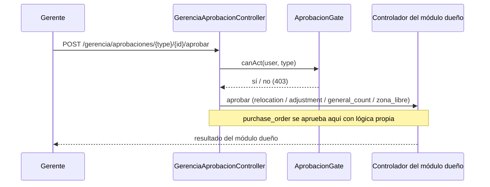

# Manual técnico — Gerencia

<!-- nav-manuales:inicio -->
> **Navegación:** [Índice de manuales](README.md) · ← [Factura Electrónica](factura-electronica.md) · [Soporte](soporte.md) →
> **Módulos relacionados:** [Ventas & Diseño](ventas-diseno.md) · [Admin & Contabilidad](admin-contabilidad.md) · [Compras](compras.md) · [Bodega](bodega.md) · [Servicios](servicios.md)
<!-- nav-manuales:fin -->

> **Para quién:** un desarrollador que nunca ha tocado este módulo y necesita entenderlo y modificarlo con seguridad.
> **Base del manual:** backend `atlanticerp-backend` rama `dev` (commit `78ebc513`, 2026-10-12) y frontend `atlanticerp-frontend` `origin/dev` (commit `95cc675`, 2026-10-12).
> **Cómo se verifica:** `python3 scripts/manual-coverage.py gerencia` comprueba que cada pieza del módulo esté nombrada aquí. Mide presencia, no calidad.
> **Documentos hermanos:** `app/Modules/Gerencia/CLAUDE.md`, diagrama `docs/architecture/diagramas/gerencia.md`, ERD `docs/architecture/erd/gerencia.md`, análisis `docs/architecture/gerencia-epic-analisis-20260826.md`, historial de Pre-QA `docs/pre-qa/gerencia-epic-scrum325/`. Manuales vecinos: `compras.md`, `bodega.md`.

---

## 1. Propósito y alcance

Gerencia es un **tablero ejecutivo de un solo vistazo** (`/gerencia`, rol `management`) que **agrega datos que ya producen otros módulos**. Casi no tiene datos propios: solo dos tablas para las reglas de aprobación.

| Área | Qué hace |
|---|---|
| **KPIs** | Variación de margen (real contra cotizado), cuentas por cobrar al día y proyectos activos. |
| **Facturación y proyectos** | Indicadores y gráfico mensual, con filtros de fechas, vendedor y cliente. |
| **Salud por módulo** | Una tarjeta por módulo (Ventas & Diseño, Admin & Contabilidad, Compras, Bodega, Servicios). |
| **Aprobaciones** | Bandeja de solicitudes pendientes de otros módulos, con aprobar y rechazar desde aquí. |
| **Reglas de aprobación** | Quién puede aprobar cada tipo de solicitud (solo superadmin las configura). |
| **Agendas y calendario** | Entregas de Bodega y visitas de Servicios del día, y "Mi calendario" de Outlook. |
| **Exportar reporte** | PDF o Excel del reporte con los filtros aplicados. |

**La regla de oro del módulo:** Gerencia **nunca reimplementa una métrica en paralelo**. Cada número reutiliza el cálculo del módulo dueño (un hallazgo real, SCRUM-168 v9, lo demostró). Si necesitas un número nuevo, reutiliza el servicio de origen; si no existe, créalo allí.

---

## 2. Mapa del código

### 2.1 Backend (`atlanticerp-backend/app/Modules/Gerencia/`)

| Archivo | Para qué |
|---|---|
| `Http/Controllers/GerenciaHomeController.php` | Home, export, vendedores, clientes y las dos bandejas de aprobaciones pendientes. |
| `Http/Controllers/GerenciaAprobacionController.php` | Aprobar y rechazar, delegando en el controlador de cada módulo. |
| `Http/Controllers/ReglaAprobacionController.php` | CRUD de reglas de aprobación. |
| `Http/Requests/ReglaAprobacionRequest.php` | Validación de las reglas. |
| `Models/ReglaAprobacion.php` | Regla (tipo → aprobadores). |
| `Services/GerenciaHomeService.php` | **Única fuente** del payload de `/gerencia/home` (unas 800 líneas). |
| `Services/GerenciaReportExportService.php` | PDF y Excel; solo formatea lo que ya calculó el Home. |
| `CLAUDE.md` | Contexto del módulo. |

Fuera de la carpeta:

| Archivo | Para qué |
|---|---|
| `routes/gerencia.php` | Rutas, montadas bajo `api/gerencia`. |
| `app/Shared/Support/AprobacionGate.php` | Gate de aprobación compartido con Compras y Bodega. |
| `app/Shared/Support/ApprovalsPendingService.php` | Agregador de "Aprobaciones pendientes" para el Home de cada módulo. |
| `app/Modules/Integrations/Outlook/.../OutlookCalendarController` | Calendario compartido (`module = gerencia`). |
| `tests/Feature/Gerencia/` | Pruebas. |

El módulo no tiene jobs, eventos, correos ni listeners.

### 2.2 Frontend (`atlanticerp-frontend/src/`)

| Archivo | Para qué |
|---|---|
| `pages/GerenciaPage.tsx` | La pantalla `/gerencia`: filtros, KPIs, gráficos, salud, aprobaciones, calendario, exportar. |
| `components/gerencia/GerenciaAprobacionesPanel.tsx` | Panel de administración de reglas de aprobación (solo superadmin). |
| `api/gerenciaApi.ts` | `gerenciaApi`: `home`, `exportHome`, `calendar`, `vendors`, `clients`, `aprobaciones`, `homeApprovalsPendingAll`, `reglasAprobacion`. |
| `hooks/useGerencia.ts` | `useGerenciaHome`, `useGerenciaVendors`, `useGerenciaClients` y `useGerenciaExport`. |
| `types/gerencia.ts` | Tipos de todo el payload del Home y de las reglas. |

### 2.3 Cómo viaja una petición

```
GerenciaPage → useGerenciaHome → gerenciaApi.home → GET /api/gerencia/home (JWT)
  → permission:gerencia.view → GerenciaHomeController::home (valida filtros)
  → GerenciaHomeService::home → [kpis, facturacion, proyectos, aprobaciones, salud_modulos, agendas]
        cada bloque reutiliza servicios y modelos de otros módulos
```

---

## 3. Modelo de datos

Esquema `{tenant}_gerencia`. ERD: `docs/architecture/erd/gerencia.md`.

| Tabla | Modelo | Qué guarda |
|---|---|---|
| `reglas_aprobacion` | `ReglaAprobacion` | `tipo` (qué clase de solicitud), `activo`, `observaciones`. |
| `regla_aprobacion_aprobadores` | — (tabla pivote de `ReglaAprobacion::aprobadores()`) | Relación N:M con usuarios; llave primaria compuesta (`regla_aprobacion_id`, `user_id`). |

**Tipos de solicitud que reconoce el sistema** (`AprobacionGate`): `purchase_order`, `relocation`, `adjustment`, `general_count` y `zona_libre`. La columna `tipo` es texto libre (la validación solo exige un `string` de hasta 255): el catálogo real de tipos y de quién aprueba cada uno **está pendiente de definir con el cliente**, y la tabla no se siembra.

No hay estados ni máquina de estados propios. Las migraciones del módulo viven en `database/migrations/tenant/` (`TenantSchemaMigration`, `$module = 'gerencia'`).

---

## 4. Reglas de negocio y parámetros

### 4.1 Filtros del Home

`desde`, `hasta` (formato `AAAA-MM-DD`, `hasta` ≥ `desde`), `vendedor_id` y `cliente_id`.

- **Por defecto en el servidor:** del primer día del mes en curso a hoy.
- **Por defecto en la pantalla:** el 1 de enero del año en curso, recalculado en cada ingreso (SCRUM-855). El frontend manda siempre las fechas, así que en la práctica manda el valor de la pantalla.
- "Salud por módulo", "CxC al día" y las agendas **no** responden a las fechas: son una fotografía del momento (o del mes en curso).

### 4.2 Qué calcula cada bloque y de dónde sale

| Bloque | Cálculo | Fuente reutilizada |
|---|---|---|
| Variación de margen | Margen real (de las cotizaciones facturadas en el período) menos margen cotizado (de las aprobadas en el período), en puntos porcentuales | `AdminContInvoice`, `PipelineCard`, `Quote`, `QuoteItem.cost` |
| CxC al día | Total, vencidas y por vencer en 7 días, sobre **saldo neto** (monto menos lo aplicado); excluye anuladas | `InvoiceService::cobrablesConVencimientoSigned()` |
| Proyectos activos | Tarjetas del pipeline en `lead`, `design`, `quote` o `proposal` | `PipelineCard` |
| Facturación | KPIs y gráfico mensual; el filtro de vendedor se resuelve por `sales_project_id` contra `PipelineCard.owner_id` (no hay llave directa) | `AdminContInvoice` |
| Proyectos | KPIs y gráfico mensual | `PipelineCard` |
| Gráfico mensual | Rellena con cero los meses sin datos para que no se estire una barra única | `zeroFillMeses()` |
| Salud · Ventas & Diseño | En etapa final, estancados, montos cotizado y aprobado del mes, total del pipeline | `PipelineCard`, `PipelineCard::STAGNANT_THRESHOLD_DAYS` |
| Salud · Admin & Contabilidad | CxC total y cuentas al día | `InvoiceService` |
| Salud · Compras | Órdenes críticas, bajo stock sin ordenar, en tránsito, próximas a llegar, órdenes abiertas | `PurchaseOrder::isCritical()`, `InventoryKpiService::lowStockWithoutOpenOrderCount()` |
| Salud · Bodega | Despachos urgentes y atrasados, despachados a tiempo, completados hoy | `Bodega\Models\Order` |
| Salud · Servicios | Tickets sin responder y completados del mes | `Servicios\Models\Ticket` |
| Agendas | Entregas de Bodega con fecha comprometida hoy (no entregadas) y visitas de Servicios agendadas hoy (agendadas o en sitio) | `Order`, `Ticket` |

**Un vendedor sin tarjetas** o una factura sin proyecto vinculado quedan fuera cuando se filtra por vendedor: no hay a quién atribuirlas.

### 4.3 Aprobaciones (el corazón del módulo)

La decisión de "¿puede este usuario actuar sobre este tipo?" es siempre `AprobacionGate::canAct($user, $tipo)`:

| Tipo | Quién puede |
|---|---|
| `purchase_order` | Solo Aprobador (`primary_approver_user_id` de `ComprasSettings`); sin override por regla. |
| `relocation`, `adjustment`, `general_count` | Aprobador, o cualquier usuario con una regla activa para ese tipo. |
| `zona_libre` | El permiso `compras.zona-libre.approve`, o una regla activa para ese tipo. |
| (cualquiera) | `superadmin.all` siempre. |

Si `primary_approver_user_id` es nulo, el gate no bloquea a nadie por ser Aprobador.

- **Bandeja:** `pendingApprovalsSection()` solo muestra las secciones para las que el usuario pasa el gate. Lo que aparece es exactamente lo que puede accionar. Cada módulo se limita a 20 ítems por bandeja en este agregador.
- **Aprobar:** para los cuatro tipos que no son orden de compra, **delega** en el controlador del módulo dueño (`RelocationRequestController`, `AdjustmentRequestController`, `GeneralCountController`, `ComprasZonaLibreRequestController`), de modo que se reutilizan sus constantes, sus bloqueos de concurrencia y sus reglas. La orden de compra mantiene una lógica propia y mínima.
- **Rechazar:** el motivo llega con el nombre público `razon` y se reasigna al campo real de cada destino (`motivo_rechazo` o `rejection_reason`). Las **órdenes de compra no se pueden rechazar desde Gerencia** (422): se rechazan desde Compras.
- **Reglas:** solo superadmin las crea, edita y borra. Exigen un tipo, un estado activo y al menos un aprobador. Borrar una regla es un borrado físico.

### 4.4 Exportar

`GET /gerencia/home/export?format=pdf|excel` reutiliza el mismo payload del Home. Cubre solo las secciones que dependen de los filtros (KPIs, facturación y proyectos). Si no hay facturas ni proyectos cerrados en el rango, responde un JSON `{ "empty": true, "message": ... }` en lugar de generar un archivo vacío.

### 4.5 Valores fijos (deuda)

Son del módulo dueño pero Gerencia los hereda: `PipelineCard::STAGNANT_THRESHOLD_DAYS`, la lista de etapas activas `ACTIVE_PIPELINE_STAGES` (constante propia de `GerenciaHomeService`), y los 7 días de "por vencer". Ver sección 13.

---

## 5. Flujos principales

### 5.1 Aprobar desde Gerencia



### 5.2 Cargar el Home

`GerenciaHomeController::home` valida los filtros y llama a `GerenciaHomeService::home($filtros, $userId)`. Cada bloque se calcula en seguida; no hay caché. El calendario no viene en este payload: `GET /gerencia/calendar` lo sirve aparte.

---

## 6. API

Base: `/api/gerencia` (dev: `https://dev.atlanticerp.ai/api/gerencia`). Generada con `scripts/manual-routes-table.py gerencia` (13 rutas). Documentación interactiva de dev: `https://dev.atlanticerp.ai/docs/api`; colección de Postman: `docs/api/exports/postman/gerencia.postman_collection.json`.

**`/gerencia/home`**

| Método | Ruta | Controlador@método | Permiso (OR) |
|---|---|---|---|
| GET | `/gerencia/home` | `GerenciaHomeController@home` | `gerencia.view` |
| GET | `/gerencia/home/export` | `GerenciaHomeController@export` | `gerencia.view` |
| GET | `/gerencia/home/approvals-pending` | `GerenciaHomeController@approvalsPending` | `gerencia.view` |
| GET | `/gerencia/home/approvals-pending-all` | `GerenciaHomeController@approvalsPendingAll` | `gerencia.view` |

**`/gerencia/vendors` y `/gerencia/clients`**

| Método | Ruta | Controlador@método | Permiso (OR) |
|---|---|---|---|
| GET | `/gerencia/vendors` | `GerenciaHomeController@vendors` | `gerencia.view` |
| GET | `/gerencia/clients` | `GerenciaHomeController@clients` | `gerencia.view` |

**`/gerencia/calendar`**

| Método | Ruta | Controlador@método | Permiso (OR) |
|---|---|---|---|
| GET | `/gerencia/calendar` | `OutlookCalendarController@index` | `gerencia.view` |

**`/gerencia/aprobaciones`**

| Método | Ruta | Controlador@método | Permiso (OR) |
|---|---|---|---|
| POST | `/gerencia/aprobaciones/{type}/{id}/aprobar` | `GerenciaAprobacionController@aprobar` | `gerencia.view` (más `AprobacionGate`) |
| POST | `/gerencia/aprobaciones/{type}/{id}/rechazar` | `GerenciaAprobacionController@rechazar` | `gerencia.view` (más `AprobacionGate`) |

**`/gerencia/reglas-aprobacion`**

| Método | Ruta | Controlador@método | Permiso (OR) |
|---|---|---|---|
| GET | `/gerencia/reglas-aprobacion` | `ReglaAprobacionController@index` | `role:superadmin` |
| POST | `/gerencia/reglas-aprobacion` | `ReglaAprobacionController@store` | `role:superadmin` |
| PUT | `/gerencia/reglas-aprobacion/{id}` | `ReglaAprobacionController@update` | `role:superadmin` |
| DELETE | `/gerencia/reglas-aprobacion/{id}` | `ReglaAprobacionController@destroy` | `role:superadmin` |

### 6.1 Notas

- **Calendario:** Gerencia queda fuera de `MODULES_WITH_TEAM_CALENDAR` a propósito: nadie ve el calendario de otro desde aquí, y el frontend nunca manda `scope=team` ni `owner_id`.
- **`approvals-pending`** siempre devuelve una lista vacía: Gerencia no tiene tipos de aprobación propios, existe solo para que los seis módulos tengan la misma forma. La vista real es **`approvals-pending-all`**, consolidada de todos los módulos que el usuario puede decidir (`ApprovalsPendingService::crossModuleForGerencia()`).
- **`/gerencia/clients`** devuelve como máximo 50 clientes maestros (búsqueda `ilike` por nombre). **`/gerencia/vendors`** devuelve a los usuarios cuyo rol puede ver Ventas & Diseño completo pero no el de equipo.

### 6.2 Validaciones

| Dónde | Reglas |
|---|---|
| `GerenciaHomeController::home` y `export` | `desde`/`hasta` en formato `AAAA-MM-DD` y `hasta` ≥ `desde`; `vendedor_id` y `cliente_id` enteros ≥ 1; `export` exige `format` en `pdf,excel`. |
| `ReglaAprobacionRequest` | `tipo` obligatorio (texto, 255 máx.), `activo` booleano obligatorio, `observaciones` opcional, `aprobador_ids` array de al menos 1 usuario existente. `authorize()` devuelve `true`: la autorización es el middleware `role:superadmin`. |
| `GerenciaAprobacionController::rechazar` | `razon` opcional, texto de hasta 500 caracteres. |

---

## 7. Permisos, roles y acceso

| Qué | Permiso o rol |
|---|---|
| Ver todo el tablero y aprobar o rechazar | `gerencia.view` (rol `management`) |
| Decidir cada tipo concreto | `AprobacionGate` (Aprobador, regla activa o permiso específico) |
| Reglas de aprobación | `role:superadmin` |

**Trampa v1/v2:** los permisos efectivos del JWT (`permissions`) pueden diferir de `$user->hasPermission()`. `GerenciaHomeController` pasa los del JWT a `ApprovalsPendingService`; `AprobacionGate::canAct()` usa `hasPermission()` para `zona_libre`. Si tocas esto, léelo del JWT y revisa el documento `ApprovalsPendingService` (explica por qué `zona_libre` mantiene la unión de ambos).

**Frontend:** la ruta `/gerencia` exige `gerencia.view`; el menú muestra el módulo si `user.modules.gerencia.view` es verdadero. El botón que abre el panel de reglas solo aparece para el rol `superadmin`.

---

## 8. Frontend

### 8.1 Pantalla

| Ruta | Página | Permiso | Qué hace |
|---|---|---|---|
| `/gerencia` | `GerenciaPage` | `gerencia.view` | Filtros (desde, hasta, vendedor, cliente), tarjetas de KPIs, gráficos mensuales con navegación a detalle por mes, salud por módulo, panel de aprobaciones con aprobar/rechazar, tarjeta "Aprobaciones pendientes" estándar, "Mi calendario" (rango día/semana/mes propio), agendas y menú de exportar PDF o Excel. |

### 8.2 Componentes

| Componente | Función |
|---|---|
| `components/gerencia/GerenciaAprobacionesPanel` | Administración de reglas de aprobación (alta, edición y borrado). El tipo es texto libre a propósito. |

### 8.3 Patrones y detalles

- **Capa de datos:** `gerenciaApi` → `useGerencia` (TanStack Query). `useGerenciaExport` es una mutación.
- **Navegación a detalle:** hacer clic en un KPI o una barra navega al módulo de origen con el filtro correspondiente (mes "AAAA-MM" para las barras, mes actual para "Monto cotizado/aprobado en el mes").
- **Dos paneles de aprobaciones, a propósito:** el panel propio (con Aprobar y Rechazar en línea) y la tarjeta estándar cross-módulo (máximo 5 más "Ver más"). Luis decidió no fusionarlos (2026-09-21).
- **Exportar:** descarga un blob con nombre `reporte-gerencia-AAAA-MM-DD.pdf|xlsx`; si el servidor responde un JSON, intenta leer una bandera de "sin datos" (ver 13).
- **i18n:** la pantalla tiene muchos textos escritos directamente en español ("Cargando...", "Error al cargar los datos..."); no todo pasa por el sistema de traducciones.

---

## 9. Eventos, jobs e integraciones

- **Eventos, jobs y listeners:** ninguno.
- **Servicios que consume** (inyectados en `GerenciaHomeService`): `AprobacionGate`, `InventoryKpiService` (de Compras) e `InvoiceService` (de Admin & Contabilidad). Además lee directamente modelos de otros módulos.
- **Controladores a los que delega:** los cuatro de aprobación (ver 4.3).
- **Calendario:** `OutlookCalendarController` con `module = gerencia`.
- **Exportación:** `dompdf` para PDF y `phpspreadsheet` para Excel, con el mismo patrón que `CashPositionExportService` de Admin & Contabilidad.

---

## 10. Configuración y datos semilla

- No hay seeders propios: las reglas de aprobación **no se siembran**; las carga el superadmin desde el panel.
- No hay variables de entorno propias.
- Los datos que muestra dependen enteramente de los otros módulos; con una base vacía el Home devuelve ceros y el export responde "sin datos".

---

## 11. Pruebas

- **Backend:** `infra/test.sh --filter=GerenciaHomeControllerTest` y `--filter=ReglaAprobacionControllerTest`. Nunca `docker compose exec laravel php artisan test` directo.
- **Frontend:** no hay pruebas Vitest propias de `GerenciaPage` ni del panel de reglas en el código revisado.
- **Playwright (`e2e/`):** ocho specs de Pre-QA de la épica: `preqa-scrum163-164-gerencia-aprobaciones-calendario-20260822.spec.ts` y las rondas `preqa-scrum-gerencia-12tickets-20260824-v3-postmerge`, `-v5-recheck`, `9tickets-20260825-v6-recheck`, `10tickets-20260826-v7-recheck` y `-v8-recheck`.
- **Gate antes de un push:** `infra/gate.sh`.

---

## 12. Recetas para modificar el módulo

### 12.1 Agregar un KPI o una tarjeta de salud
1. **Primero** reutiliza el cálculo del módulo dueño; si no existe como servicio, créalo allí (con su prueba) y llámalo desde `GerenciaHomeService`.
2. Añade la clave al arreglo que devuelve el bloque (`kpis`, `saludModulos`...).
3. Frontend: tipo en `types/gerencia.ts`, tarjeta en `GerenciaPage.tsx`.
4. Si debe aparecer en el reporte exportado, añádelo en `GerenciaReportExportService` (solo formatea).
5. Prueba en `GerenciaHomeControllerTest`.

### 12.2 Agregar un tipo de solicitud aprobable
1. Define el tipo en `AprobacionGate` (`canAct`, y `TIPOS_CON_OVERRIDE_REGLA` si Gerencia puede delegarlo).
2. Agrega su sección en `GerenciaHomeService::pendingApprovalsSection()` y en `ApprovalsPendingService`.
3. Agrega aprobar y rechazar en `GerenciaAprobacionController` (delegando al controlador del módulo dueño, con su campo de motivo de rechazo).
4. Frontend: `AprobacionItem`, navegación al módulo de origen y textos.
5. Pruebas de autorización (con y sin regla activa).

### 12.3 Cambiar quién configura las reglas
Hoy: `role:superadmin` en `routes/gerencia.php`. Cámbialo ahí y en la condición del botón en `GerenciaPage.tsx`. Es una decisión del cliente, pendiente.

### 12.4 Agregar un filtro al Home
Regla en el `validate` de `home` y `export`, parámetro en `GerenciaHomeService::home()` y en los bloques afectados; tipo `GerenciaFilters` y selector en `GerenciaPage`.

---

## 13. Problemas conocidos y deuda

**Probable defecto en "Exportar a Excel" (verificado leyendo ambos lados; no reproducido en ejecución).** El frontend envía `format=xlsx`, pero el backend solo acepta `format` en `pdf,excel` y respondería 422 para Excel. Además, cuando no hay datos el backend responde `{ "empty": true }`, y el frontend busca una bandera `no_data` que no existe: en ese caso descargaría el JSON como si fuera un archivo `.pdf` o `.xlsx`. Las pruebas del backend usan `format=pdf` y comprueban `empty`, por eso no lo atrapan. Hay que confirmarlo en dev y abrir un ticket.

**Definiciones distintas de "urgente".** Gerencia cuenta como "despachos urgentes" los pedidos con fecha comprometida **hasta hoy**, mientras Bodega define "urgente" con una ventana configurable (`urgente_ventana_dias`, por defecto 1 día). Contradice la regla de no reimplementar métricas; no se verificó cuánto difieren los números en la práctica.

**Rendimiento.** `saludModulos()` carga todas las órdenes de compra no recibidas en PHP para contar las críticas; `GerenciaHomeService` calcula todo en cada carga, sin caché.

**Aprobación de órdenes de compra desde Gerencia.** Es una implementación mínima y propia que fija `approved_by` sin comprobar si la orden requería aprobación (el gate ya limita a Aprobador). Está fuera del rediseño a propósito (es el flujo de dinero real), pero duplica `PurchaseOrderController::approve()`.

**Reglas de aprobación.**
- `tipo` es texto libre: se puede crear una regla con un tipo que ningún gate reconoce y no tendría efecto.
- Borrar una regla es físico; no hay historial.
- Quién puede configurarlas está pendiente de definir con el cliente.

**Comentarios desactualizados** (el código manda): el docblock de `GerenciaHomeService` dice que `aprobaciones` es `[]` ("módulo no construido aún") y que las agendas retornan `[]` "pendiente de fuente real": ambas ya se calculan con datos reales.

**Tamaño.** `GerenciaHomeService` tiene unas 800 líneas; candidato a dividir por bloque.

**Estado funcional.** Según el `CLAUDE.md` del módulo, 14 de los 17 tickets de la épica están en `UAT` y 3 en `PM Review` (SCRUM-157, 159, 167).

**Trampas de implementación**
- Permisos v1 contra v2 (ver 7).
- Un filtro de vendedor sobre facturas pasa por `PipelineCard.owner_id`, con una relación 1:1 por convención sin restricción en la base.
- El calendario no forma parte del payload del Home.
- El frontend local puede estar desfasado respecto a `origin/dev`.

---

## 14. Glosario

| Término | Significado |
|---|---|
| **Regla de aprobación** | Fila que dice qué usuarios pueden aprobar un tipo de solicitud. |
| **Gate de aprobación** | `AprobacionGate`, la decisión única de quién puede actuar sobre qué tipo. |
| **CxC** | Cuentas por cobrar. "Al día" = no vencidas. |
| **Margen real / cotizado** | Margen de lo facturado / de lo aprobado en el período. |
| **Salud por módulo** | Tarjeta resumen de un módulo en el Home. |
| **Aprobador** | Aprobador configurado en `ComprasSettings.primary_approver_user_id`. |
| **Pipeline** | Embudo de proyectos de Ventas & Diseño (`PipelineCard`). |

<!-- nav-manuales:inicio -->
---
**Navegación:** [Índice de manuales](README.md) · ← [Factura Electrónica](factura-electronica.md) · [Soporte](soporte.md) →
<!-- nav-manuales:fin -->
