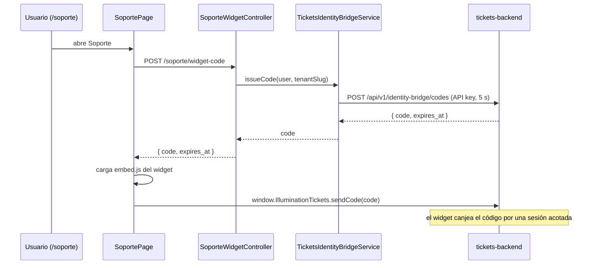

# Manual técnico — Soporte

<!-- nav-manuales:inicio -->
> **Navegación:** [Índice de manuales](README.md) · ← [Gerencia](gerencia.md) · fin →
> **Módulos relacionados:** ninguno
<!-- nav-manuales:fin -->

> **Para quién:** un desarrollador que nunca ha tocado este módulo y necesita entenderlo y modificarlo con seguridad.
> **Base del manual:** backend `atlanticerp-backend` rama `dev` (commit `78ebc513`, 2026-10-12) y frontend `atlanticerp-frontend` `origin/dev` (commit `95cc675`, 2026-10-12).
> **Cómo se verifica:** `python3 scripts/manual-coverage.py soporte` comprueba que cada pieza del módulo esté nombrada aquí. Mide presencia, no calidad.
> **Documentos hermanos:** spec `docs/specs/soporte-tickets-integracion.md` (SCRUM-923), diagrama `docs/architecture/diagramas/soporte.md`, API `docs/api/exports/openapi/soporte.json`. El sistema externo vive en otro repositorio (`Illumination/tickets/`) con su propio contrato (`integrador-externo.md`) y su modelo de amenazas del Identity Bridge.

---

## 1. Propósito y alcance

Soporte embebe dentro de AtlanticERP el widget de **Illumination Support Tickets** (`tickets.atlanticerp.ai`), un sistema aparte donde los usuarios ven, crean y comentan sus tickets de soporte. AtlanticERP solo hace de **integrador**: le demuestra al sistema de tickets quién es el usuario logueado, sin compartirle ni su JWT ni su sesión.

Es el módulo más pequeño del proyecto: **un endpoint, un servicio, una página y ninguna tabla**.

| Qué hace | Qué no hace |
|---|---|
| Pide al sistema de tickets un código de un solo uso para el usuario actual (*Identity Bridge*). | No guarda tickets, usuarios ni nada en la base de AtlanticERP. |
| Muestra el widget en `/soporte` y le entrega el código. | No implementa tickets: es todo del sistema externo. |
| Visible para **cualquier usuario autenticado** (decisión de Luis, 2026-09-16). | No lleva permiso propio. |

---

## 2. Mapa del código

### 2.1 Backend (`atlanticerp-backend/app/Modules/Soporte/`)

| Archivo | Para qué |
|---|---|
| `Http/Controllers/SoporteWidgetController.php` | Un único método, `issueCode()`. Resuelve usuario y tenant desde el JWT. |
| `Services/TicketsIdentityBridgeService.php` | Llamada servidor a servidor al sistema de tickets. Protegida con `CircuitBreaker`. |

Fuera de la carpeta:

| Archivo | Para qué |
|---|---|
| `routes/soporte.php` | La ruta, montada bajo `api/soporte` en `bootstrap/app.php` con el grupo `api` (JWT obligatorio). |
| `config/services.php`, clave `tickets` | `base_url` y `api_key`. |
| `.env.example` | `TICKETS_BASE_URL` y `TICKETS_API_KEY`. |
| `tests/Feature/Soporte/SoporteWidgetControllerTest.php` | Pruebas del módulo. |

El módulo no tiene Form Requests, modelos, jobs, eventos, correos ni listeners.

### 2.2 Frontend (`atlanticerp-frontend/src/`)

| Archivo | Para qué |
|---|---|
| `pages/SoportePage.tsx` | La pantalla `/soporte`: pide el código, carga el script del widget y se lo entrega. |
| `api/soporteApi.ts` | `soporteApi.getWidgetCode()`. |
| `types/soporte.ts` | `SoporteWidgetCodeResponse` (solo `code`). |
| `i18n/locales/{es,en}/soporte.json` | Textos: título, subtítulo, "cargando" y "no disponible". |
| `App.tsx`, `components/Sidebar.tsx` | Ruta `/soporte` (sin `RequirePermission`) y su ítem de menú (sección propia, ícono de salvavidas). |

### 2.3 Cómo viaja una petición

```
Navegador (/soporte) ──POST /api/soporte/widget-code (JWT)──▶ SoporteWidgetController
        ▲                                                         │ resuelve user + tenant del JWT
        │ code (un solo uso)                                      ▼
   widget (embed.js) ◀───────────────────────────  TicketsIdentityBridgeService ──HTTP + API key──▶ tickets-backend
                                                     (CircuitBreaker 'tickets-identity-bridge')
```

---

## 3. Modelo de datos

**Ninguno.** Soporte no tiene tablas, migraciones ni esquema propio (por eso no existe ERD). Toda la información de tickets vive en el sistema externo.

---

## 4. Reglas de negocio y parámetros

- **Quién:** cualquier usuario autenticado. No hay gate de permiso.
- **Identidad que se envía:** `external_user_id = "{slug_del_tenant}:{id_del_usuario}"`, más nombre completo y correo del usuario. Ese es el contrato con el sistema externo.
- **Código:** de un solo uso y de unos 60 segundos de vida. Se pide **nuevo en cada carga** de `/soporte`; nunca se guarda ni se reutiliza.
- **Límite de uso:** 20 peticiones por minuto (`throttle:20,1` en la ruta).
- **Si el sistema externo falla** o el circuito está abierto, el servidor responde **503** con un mensaje genérico (`Soporte no disponible en este momento.`) y registra el error con `report()`. Nunca se filtra el detalle del fallo al cliente.

**Parámetros (variables de entorno, no tablas):**

| Variable | Para qué | Valor |
|---|---|---|
| `TICKETS_BASE_URL` | URL del sistema de tickets | por defecto `https://tickets.atlanticerp.ai` |
| `TICKETS_API_KEY` | Clave del tenant "atlanticerp" en el sistema de tickets | **secreto**: la entrega Luis; va en el `.env` de cada entorno, jamás en el repositorio |

El tiempo de espera (5 s) del servicio, el límite de 20 por minuto y el nombre del circuito están en el código; son controles técnicos, no reglas comerciales.

---

## 5. Flujo principal



El frontend ejecuta tres pasos independientes que confluyen: (1) pedir el código, (2) cargar el script del widget, (3) entregar el código cuando ya tiene las dos cosas. `embed.js` ya reintenta internamente durante unos 2 segundos si `sendCode()` se llama antes de que el widget termine de montarse, así que no hace falta un `postMessage` propio.

---

## 6. API

Base: `/api/soporte`. Una sola ruta (generada con `scripts/manual-routes-table.py soporte`):

| Método | Ruta | Controlador@método | Permiso (OR) |
|---|---|---|---|
| POST | `/soporte/widget-code` | `SoporteWidgetController@issueCode` | `(la comprueba el controlador) · throttle:20,1` |

**Respuestas**

| Código | Cuándo |
|---|---|
| 200 | `{ "code": "...", "expires_at": "..." }`. El frontend solo usa `code`. |
| 401 | Sin JWT válido, sin tenant en el JWT o tenant inexistente. |
| 429 | Más de 20 peticiones por minuto. |
| 503 | El sistema de tickets responde con error o el circuito está abierto. |

La documentación interactiva de dev (`https://dev.atlanticerp.ai/docs/api`) y la colección de Postman (`docs/api/exports/postman/soporte.postman_collection.json`) incluyen esta ruta. No se define cuerpo de la petición.

---

## 7. Permisos, roles y acceso

- **Backend:** sin middleware `permission:`; basta el grupo `api` (JWT válido). El controlador solo exige que el JWT traiga `sub` y `tenant`.
- **Frontend:** la ruta `/soporte` no usa `RequirePermission`; el menú siempre muestra la sección.
- **Nota de seguridad:** la API key de tickets vive solo en el servidor. El navegador nunca la ve, y el widget nunca ve el JWT de AtlanticERP.

---

## 8. Frontend

| Ruta | Página | Permiso | Qué hace |
|---|---|---|---|
| `/soporte` | `SoportePage` | ninguno (autenticado) | Muestra el widget de tickets dentro de una tarjeta de al menos 500 px de alto. |

**Estados de la página:** "cargando" mientras falta el código o el script; el widget visible cuando ambos están listos; un mensaje de "no disponible" con ícono de alerta si falla el pedido del código **o** la carga del script.

**Cómo está hecho el embebido:** `SoportePage` crea un `<script>` con `src = https://tickets.atlanticerp.ai/embed.js`, `data-tenant="atlanticerp"` y `data-container="soporte-widget"`, lo agrega al `body` y lo retira al salir. No hay `<iframe>` propio ni `postMessage`: el script del widget gestiona eso. El tipo global `window.IlluminationTickets.sendCode(code)` se declara en la propia página.

**Política de contenido de nginx:** `infra/nginx/security-headers.conf` ya permite `https://tickets.atlanticerp.ai` en `script-src`, `connect-src` y `frame-src` (hoy en modo solo informe). Si cambia el dominio del widget, hay que actualizarla.

---

## 9. Eventos, jobs e integraciones

- **Eventos / jobs / listeners:** ninguno.
- **Integración externa:** Illumination Support Tickets, por HTTP.
  - Endpoint: `POST {TICKETS_BASE_URL}/api/v1/identity-bridge/codes`.
  - Autenticación: `Authorization: Bearer {TICKETS_API_KEY}`.
  - Cuerpo: `external_user_id`, `requester_name`, `requester_email`.
  - Espera máxima: 5 segundos. Resiliencia: `CircuitBreaker('tickets-identity-bridge')` y falla con `RuntimeException('tickets-identity-bridge: <estado>')`.
- **Módulo hermano:** `Lumo` (SCRUM-925) usa el mismo patrón con `LumoIdentityBridgeService` y `services.lumo`.

---

## 10. Configuración y datos semilla

- Definir `TICKETS_API_KEY` en el `.env` de cada entorno (dev, test, producción). Si falta o es inválida, el pedido falla y el usuario ve "no disponible" (el servicio lo trata como cualquier otro error del sistema externo).
- No hay seeders ni comandos propios.
- Para probar localmente sin el servicio real, las pruebas simulan la respuesta HTTP (`Http::fake`).

---

## 11. Pruebas

- **Backend:** `infra/test.sh --filter=SoporteWidgetControllerTest`. Cuatro casos: 401 sin autenticar, emite el código a un usuario autenticado sin permiso especial, 503 genérico si el sistema de tickets cae y límite de 20 por minuto. Nunca usar `docker compose exec laravel php artisan test` directo.
- **Frontend:** no hay prueba Vitest propia de `SoportePage`.
- **Navegador:** `e2e/preqa-scrum925-923-lumo-soporte-20260916.spec.ts` (Pre-QA conjunto de Lumo y Soporte).
- **Gate antes de un push:** `infra/gate.sh`.

---

## 12. Recetas para modificar el módulo

### 12.1 Cambiar la URL del sistema de tickets
1. Cambia `TICKETS_BASE_URL` en el `.env` del entorno (afecta solo al pedido del código).
2. **Cambia además la URL del script en `SoportePage.tsx`**: está escrita a mano y no lee `TICKETS_BASE_URL`.
3. Actualiza la política de contenido de nginx (`security-headers.conf`).

### 12.2 Cambiar los datos de identidad que se envían
Edita el cuerpo en `TicketsIdentityBridgeService::issueCode()`. Antes, confirma el contrato con el sistema externo (`integrador-externo.md`): `external_user_id` debe seguir el formato `tenant:usuario` o el sistema de tickets no reconocerá a las personas ya existentes.

### 12.3 Restringir quién ve Soporte
Hoy es público para cualquier autenticado. Para acotarlo: middleware `permission:` en `routes/soporte.php`, `RequirePermission` en `App.tsx` y el ítem de `Sidebar.tsx`. Requiere decisión de Luis y un permiso nuevo en el catálogo (migración y `SpecialPermissionSeeder`).

### 12.4 Agregar otro integrador del mismo tipo
Copia el patrón (`Soporte`, `Lumo`): un servicio con `CircuitBreaker`, un controlador delgado con límite de uso, una clave en `config/services.php` y variables de entorno, sin tablas.

---

## 13. Problemas conocidos y deuda

- **URL del widget fija en el frontend.** `SoportePage` carga siempre `https://tickets.atlanticerp.ai/embed.js` con `data-tenant="atlanticerp"`, aunque el backend lea `TICKETS_BASE_URL`. En dev y test el widget apunta a producción del sistema de tickets, y el código lo emite un servidor que podría apuntar a otra URL: hay riesgo de desajuste si se cambia la variable.
- **`expires_at` se descarta.** El backend lo devuelve, pero el frontend solo usa `code` y no reintenta si el código expira antes de entregarse.
- **Sin prueba del frontend** y sin prueba de que la API key falte.
- **Dependencia externa sin degradación fina:** cualquier fallo se reduce al mensaje "no disponible"; no distingue entre sistema caído, clave inválida o usuario rechazado.
- **Clave en el servidor:** su alta y su rotación son manuales; este repositorio no documenta un procedimiento.
- **Origen del módulo:** la spec la escribió una sesión de otro proyecto sin pasar por el flujo normal de AtlanticERP; hay decisiones (por ejemplo "visible a cualquier usuario") que no pasaron por el Arquitecto.

---

## 14. Glosario

| Término | Significado |
|---|---|
| **Identity Bridge** | Mecanismo por el que AtlanticERP demuestra al sistema de tickets quién es el usuario mediante un código de un solo uso. |
| **tickets-backend** | Servicio externo de Illumination Support Tickets. |
| **Widget** | Interfaz de tickets que se incrusta con `embed.js`. |
| **Código de un solo uso** | Valor de ~60 s que el widget canjea por una sesión acotada. |
| **Circuit breaker** | Protección que corta las llamadas a un servicio externo caído para no esperar en vano. |
| **Tenant** | Cliente del sistema multitenant; aquí el slug que acompaña al id de usuario. |

<!-- nav-manuales:inicio -->
---
**Navegación:** [Índice de manuales](README.md) · ← [Gerencia](gerencia.md) · fin →
<!-- nav-manuales:fin -->
